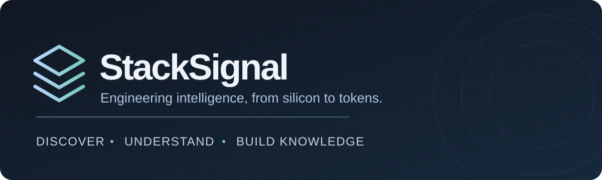
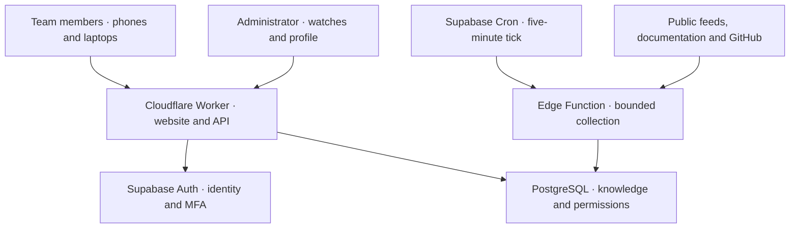
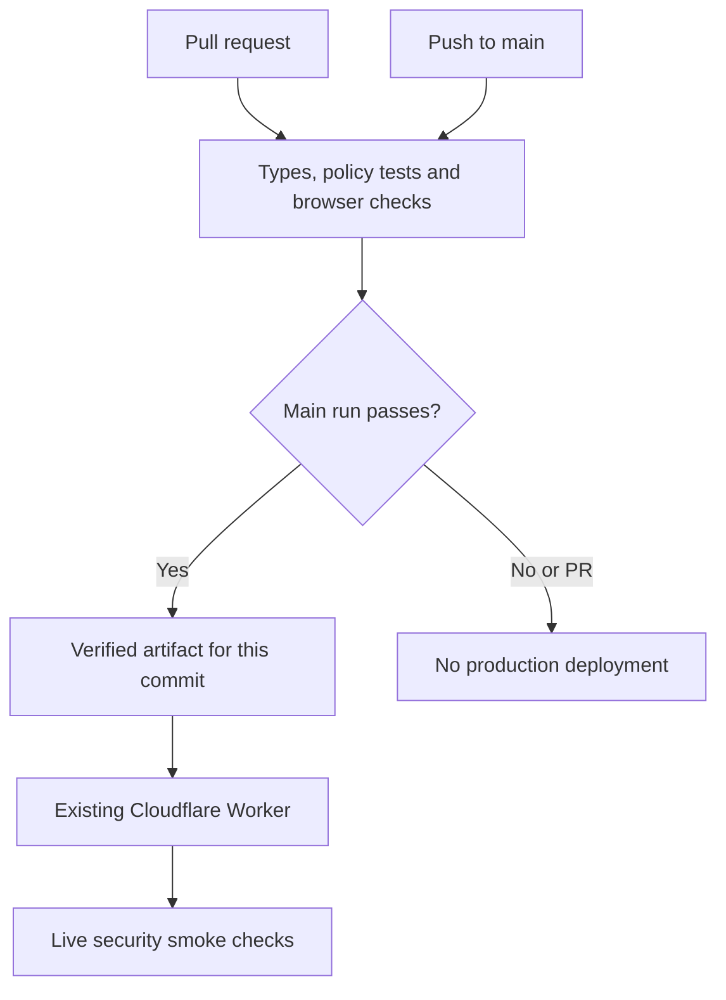

<p align="center">
  
</p>

<p align="center">
  <a href="https://github.com/Idoheled/StackSignal/actions/workflows/ci.yml"></a>
  
  
  
</p>

<p align="center">
  <strong>The right knowledge. Across the whole stack. In one team workspace.</strong><br />
  Follow the projects you depend on, discover the work you have not encountered, and turn useful links into shared engineering knowledge.
</p>

<p align="center">
  <a href="https://stacksignal.stacksignal-idoheled.workers.dev"><strong>Open StackSignal</strong></a> ·
  <a href="docs/ONBOARDING.md">Start here</a> ·
  <a href="docs/PRODUCT.md">Product guide</a> ·
  <a href="docs/ARCHITECTURE.md">Architecture</a> ·
  <a href="docs/README.md">Documentation hub</a>
</p>

---

## Why StackSignal exists

An AI infrastructure team works across hardware, lossless networking, Kubernetes, GPU scheduling, model serving and organizational traffic controls. A firmware change, an operator release or a new cache-routing technique can matter as much as a new model. Keeping up means following many publishers and projects while preserving the context that makes each discovery useful.

**StackSignal is a private engineering intelligence and knowledge workspace built for that entire chain, from silicon to tokens.** It collects public technical material, explains its relevance to the team's stack, and gives the team a searchable place to save, discuss and revisit it.

> **“I don't know what I don't know.”**
>
> Watch the known dependencies. Explore beyond them. Keep the original evidence close.

Discovery combines explicit source watches with public feeds and repository searches. The shared library captures what people learn. Human judgment connects the two: a useful link becomes a saved reference, a discussion, or feedback that informs future ranking.

## A daily workflow

| Step | What the team gets |
| --- | --- |
| **Catch up** | A weekly feed of publisher-dated material, followed releases, recently discovered projects and documentation changes |
| **Understand** | Titles, source/author metadata when available, separate date fields, relevance reasons and supporting excerpts |
| **Decide** | Read the original; mark a suggestion helpful or not relevant; keep personal read state |
| **Keep** | Save a link in nested shared folders; search saved titles across the whole library or a folder subtree |
| **Collaborate** | Add team-visible comments and replies, or an author-private note |
| **Improve coverage** | Submit a missed public link; administrators tune watches, priorities, queries and the technical profile |

Administrators and maintainers curate content. Read-only members browse and read it. See the [role matrix](docs/ONBOARDING.md#roles-and-permissions) before inviting colleagues.

## Coverage: one stack, many layers

| Layer | Examples of the knowledge StackSignal tracks |
| --- | --- |
| **Hardware and provisioning** | Cisco, Dell, HPE and NVIDIA; BIOS/PCIe/NUMA; firmware; Redfish; NetBox; Foreman |
| **Network and data movement** | RoCE, InfiniBand, GPUDirect, NCCL, DeepEP, PFC/ECN and rail alignment |
| **Platform and placement** | OpenShift/Kubernetes, operators, DRA/DRANET, KAI, NFD/NRO, nmstate, PerformanceProfile and RuntimeClass |
| **Serving and memory** | KServe, vLLM, llm-d, Dynamo, LWS, KV-cache offloading, LMCache, KVBM, NIXL and model loading |
| **Routing and operations** | Envoy Gateway, Agent Router, inference extensions, Kuadrant, token policies and observability |
| **Evidence and emerging work** | MLPerf, AIPerf, perftest, nccl-tests, DCGM, RDMA tooling, quantization, speculative decoding and adjacent AI tools |

The initial import contains **136 public references in 29 folders**. These are seed-library counts, not a live inventory. Watches and discovery preferences evolve through administration. [Coverage and provenance](docs/COVERAGE.md) explains the initial material and its review status.

## How everything connects



The website and collector run independently. Collection continues while the team is offline; opening the site reads the stored results. PostgreSQL is the durable source of truth for the library, notes, membership, source definitions, queue and feedback.

| Component | Responsibility |
| --- | --- |
| **React + TypeScript UI** | Responsive reading, search, folders, discussion, account flows and administration |
| **Vinext + Vite on Cloudflare Workers** | Server rendering, protected API gateway, encrypted sessions and security headers |
| **Supabase Auth** | Password verification and TOTP factors; the product login uses usernames |
| **Supabase PostgreSQL** | Data, database authorization, audited mutations, queue leases and usage counters |
| **Supabase Edge Function + Cron** | Scheduled fetching, extraction, normalization, relevance and retry/deferral |
| **GitHub Actions** | Types, policy tests, browser checks, verified build deployment and live smoke checks |

Read the [architecture](docs/ARCHITECTURE.md) for request paths, data relationships and trust boundaries, and the [design decisions](docs/DESIGN.md) for the reasoning behind them.

## Discovery and relevance

StackSignal has several complementary discovery lanes:

- **Followed projects:** poll GitHub releases and supported issue/PR endpoints. Stable releases are the default; prereleases require an administrator's opt-in.
- **Publications:** consume feeds and approved documentation pages; preserve publisher metadata and detect meaningful page changes.
- **New projects:** run administrator-editable public repository queries, alternating popularity and recency to widen the radar.
- **Team submissions:** preserve a missed link, queue supported metadata extraction, save it and optionally record helpful feedback.
- **Optional providers:** Gemini analysis and Tavily web discovery require explicit configuration and budgets. Their budgets start at zero and they are currently disabled.

Ranking uses concrete technical terms, topic priorities, administrator interests, release signals and bounded feedback. Cards explain the match; scores express **relevance**, not truth or production readiness. There is no mandatory LLM in the default collection path.

The five-minute collector tick handles due queued work. Individual watches have their own intervals, and source outages or provider quotas can delay results. Alerts appear **inside StackSignal**; they are polling-based, not email/push notifications. See [how the feed works](docs/PRODUCT.md#the-five-feed-views).

## Guiding principles and guardrails

| Principle | What it means in this system |
| --- | --- |
| **Evidence stays visible** | Keep canonical/original URLs, source context and distinct publication/discovery/change dates. Unknown metadata stays unknown. |
| **People control relevance** | Explain ranking, bound feedback, let administrators tune discovery, and confirm dismissals/destructive actions. |
| **Private by design** | Invitation-only membership, server/database authorization, writer MFA and author-private notes. A public source repository does not grant workspace access. |
| **Public material is untrusted** | Approved-host fetching, request/size/time limits and text-only rendering. A page cannot change system instructions or execute tools. |
| **Zero-spend default** | Core collection needs no paid AI API. Provider quotas remain finite, budgets are enforced, and optional paid integrations are off. |
| **Knowledge survives releases** | Preserve accounts, folders, notes and watches. Use additive migrations; keep frontend, database and collector rollouts separate. |
| **Phones are a primary interface** | Wrapping titles, a full-width phone detail pane, safe-area spacing, accessible controls and browser-engine regressions. |

**Coverage is bounded.** The hub does not guarantee discovery of every useful publication, verify benchmark claims, or fetch arbitrary submitted hosts. Private notes are access-controlled, not end-to-end encrypted. Product capacity is capped at 100 members; that cap is not a load-test certification. Read [security controls and verification limits](docs/SECURITY.md).

## Start with your role

| You are… | Start here | Then read |
| --- | --- | --- |
| **A team member** | [Join, sign in and build your reading routine](docs/ONBOARDING.md#team-members) | [Product guide](docs/PRODUCT.md) |
| **An administrator** | [Invite people and tune coverage](docs/ONBOARDING.md#administrators) | [Coverage](docs/COVERAGE.md), [security](docs/SECURITY.md) |
| **A developer** | [Get a safe local checkout](docs/ONBOARDING.md#developers) | [Architecture](docs/ARCHITECTURE.md), [development](docs/DEVELOPMENT.md), [contributing](CONTRIBUTING.md) |
| **An operator** | [Understand the existing deployment](docs/ONBOARDING.md#operators) | [Deployment and rollback](docs/DEPLOYMENT.md), [operations history](docs/OPERATIONS.md) |
| **Creating a separate installation** | [Independent setup](docs/SETUP.md) | [Security](docs/SECURITY.md), [deployment](docs/DEPLOYMENT.md) |

### Developer quick start

Use **Node.js 24** and **pnpm 11.25.0**. The checks below use synthetic data and require no production credentials.

```sh
git clone https://github.com/Idoheled/StackSignal.git
cd StackSignal
corepack enable
pnpm install --frozen-lockfile
pnpm typecheck
pnpm typecheck:collector
pnpm test
pnpm build:standalone
node scripts/verify-client-boundary.mjs
```

For browser checks on a supported developer machine or GitHub runner:

```sh
pnpm exec playwright install --with-deps chromium firefox webkit
pnpm test:browser
```

The browser suite uses intercepted synthetic API responses. Opening a build manually does not create a logged-in production session. Use [developer onboarding](docs/ONBOARDING.md#developers) for the distinction between regression checks and a separately configured integration environment.

## Delivery and maintenance



Every eligible push to `main` deploys automatically after checks pass. Production uses the verified artifact from that run and preserves runtime configuration. Pull requests do not receive deployment credentials. A failed post-deployment smoke check requires operator review; it does not automatically roll back.

**Existing production is already configured. Do not bootstrap the administrator, reset the database or repeat the original import.** Frontend CI does not apply database migrations or deploy the collector. Follow [deployment/rollback](docs/DEPLOYMENT.md) for those separate changes.

## Find your way around the source

| Path | Responsibility |
| --- | --- |
| [`app/`](app/) | App entry, API dispatch, styles and viewport metadata |
| [`components/`](components/) | Workspace, account flows, administration and UI primitives |
| [`lib/server/`](lib/server/) | Auth gateway, authorization checks, sessions and request security |
| [`lib/`](lib/) and [`data/`](data/) | Domain types, source configuration, URL normalization and sanitized seed references |
| [`supabase/migrations/`](supabase/migrations/) | Schema, RLS, roles/MFA, invitations, queues and compatibility changes |
| [`supabase/functions/`](supabase/functions/) | Collector and shared extraction/GitHub/relevance modules |
| [`tests/`](tests/) | Security, database, knowledge, collector and responsive browser regressions |
| [`scripts/`](scripts/) | Builds, asset validation, guarded deployment and independent-setup utilities |
| [`.github/`](.github/) | CI/CD, ownership, issue/PR templates and dependency maintenance |
| [`docs/`](docs/) | Product, onboarding, architecture, design, development and operations |
| [`build/`](build/) and [`vendor/`](vendor/) | Preserved third-party integration code and notices |

## Common questions

**Does StackSignal need an AI subscription?** No. Core collection and deterministic relevance work without one. A consumer AI subscription does not provide unlimited API access; optional providers need their own configuration and bounded usage.

**Will adding a link automatically monitor its entire website?** No. A submission creates a reference and queues supported analysis. An administrator explicitly adds a watch or changes discovery queries. Arbitrary hosts never expand the fetch allowlist.

**Does “new to radar” mean newly published?** No. It means newly discovered by this workspace. Publication dates, discovery dates and detected changes are deliberately separate.

**Is the source public but the knowledge workspace private?** Yes. Login assets are public; team data requires an active invited account. The owner-only Sites fallback remains a separate publication; the team uses the Cloudflare link above.

**How should I contribute or report a security issue?** Follow [CONTRIBUTING.md](CONTRIBUTING.md) for changes and [SECURITY.md](SECURITY.md) for private vulnerability reporting. Keep credentials, confidential chats and private exports out of the repository.

---

**Next:** [Onboarding](docs/ONBOARDING.md) · [Product guide](docs/PRODUCT.md) · [Design decisions](docs/DESIGN.md) · [All documentation](docs/README.md) · [Changelog](CHANGELOG.md)
