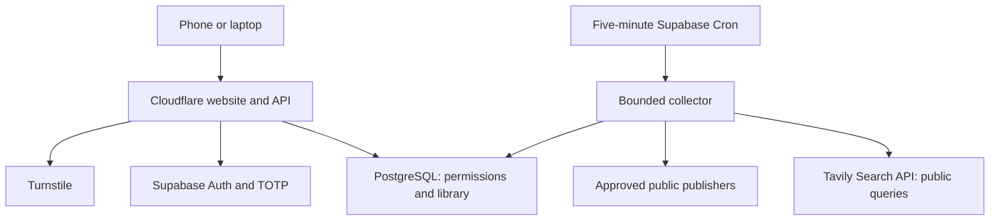
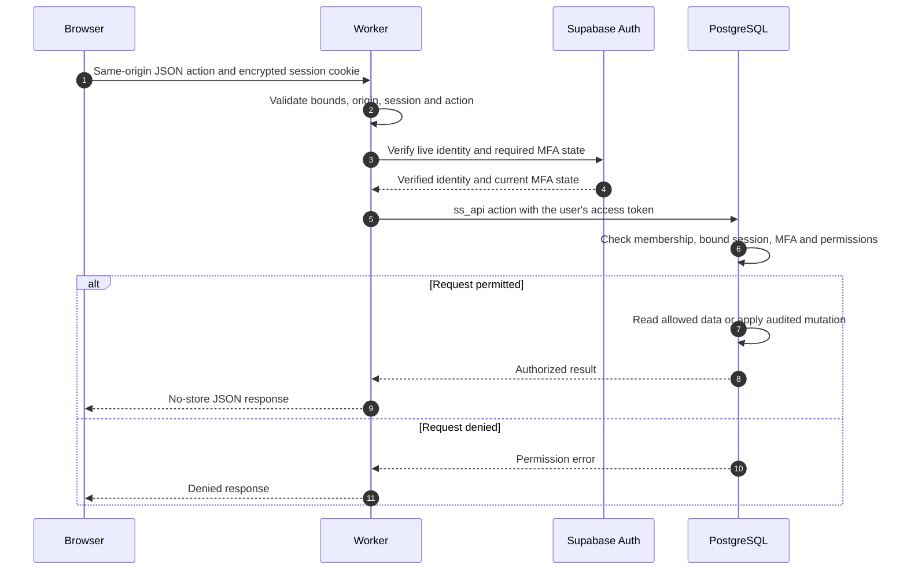
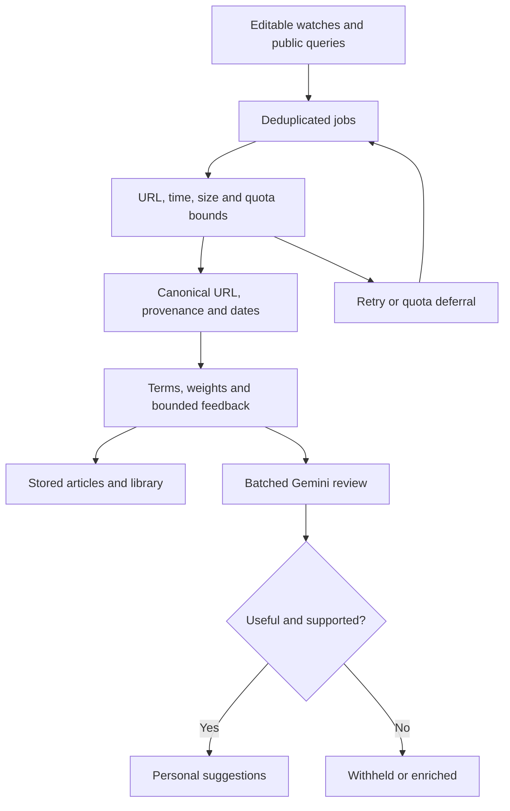
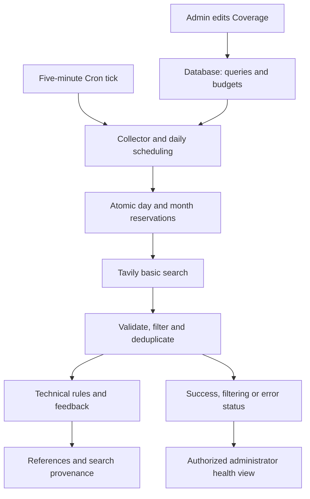
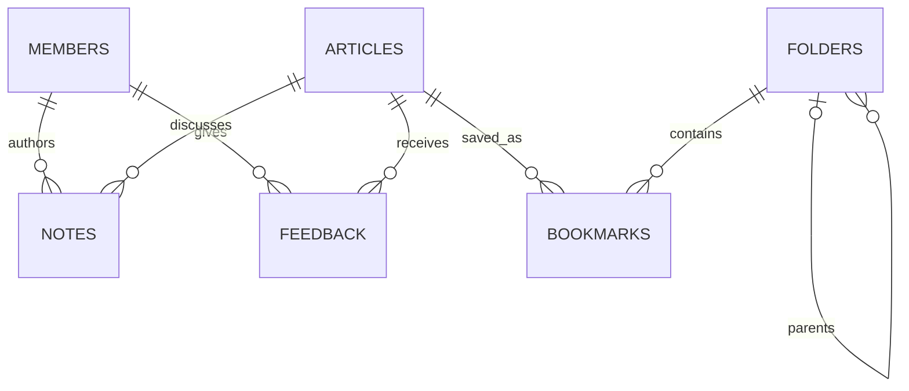
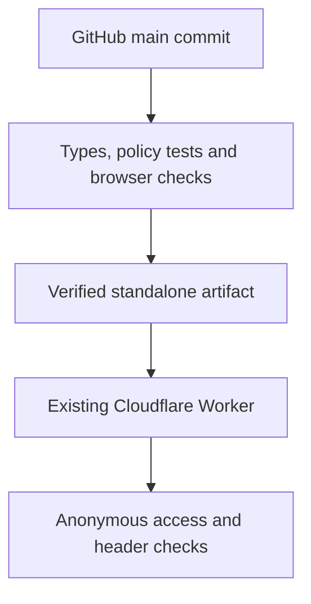

# Architecture

[Documentation hub](README.md) · [Design decisions](DESIGN.md) · [Developer onboarding](ONBOARDING.md#developers)

The Cloudflare Worker serves the authenticated website. A scheduled Supabase Edge Function collects public sources independently. PostgreSQL is the durable source of truth. No private team notes or organization LLM endpoint are needed for collection.

## Authorization

The browser receives the login shell and public JavaScript, not the private seed catalog or provider keys. `lib/server/service.ts` handles provider Auth and the authorization gateway; `lib/server/security.ts` handles origins, input bounds and encrypted sessions. Cookies are host-only, Secure, HttpOnly and SameSite. Server and database checks enforce active membership, provider-session validity, writer MFA, roles and note visibility.

Usernames map to non-deliverable internal Auth identifiers; Supabase manages password hashes. Public signup is disabled. Administrator invitations are expiring and one-time. Readers cannot modify shared content. `worker.ts` adds security headers and fresh CSP script nonces. Mutations require the configured exact origin.

The owner-only Sites publication has a separate outer gate. The standalone build omits that gate while retaining application authentication. The source repository is public; the team workspace remains invitation-only. Public login assets do not confer access to private records.

### A representative authenticated request

The central business endpoint is `POST /api/action`, using `{ action, payload }`. The server allows only enumerated actions; the database applies action-specific permissions. Read actions also use this dispatcher. Account/login/MFA routes are handled separately. Unknown actions do not become arbitrary SQL or arbitrary provider requests.

| Boundary | Enforcement | Source entry point |
| --- | --- | --- |
| Browser → Worker | Same-origin JSON, size bounds, encrypted cookie and persistent rate limits | [security.ts](../lib/server/security.ts), [service.ts](../lib/server/service.ts) |
| Worker → identity provider | Live token/user verification and current MFA checks; no trust in decoded claims alone | [service.ts](../lib/server/service.ts) |
| User token → database | Active member, bound/unrevoked session, role/MFA and note visibility | [migrations](../supabase/migrations/) |
| Collector caller → Edge Function | Dedicated collector secret; no public collection trigger | [collector](../supabase/functions/collector/index.ts) |
| Collector → publisher | Controlled host allowlist, public-address/redirect checks and bounded requests | [content.ts](../supabase/functions/_shared/content.ts), [collector](../supabase/functions/collector/index.ts) |
| Public text → UI/optional AI | Text-only rendering; bounded structured output/evidence, recorded Flash Latest resolved version; no model tools/private context | [workspace](../components/workspace.tsx), [collector](../supabase/functions/collector/index.ts) |

Provider service credentials remain server-side. The user-facing business RPC uses the authenticated user's token so database permission checks retain user identity. Collector/service tasks use separate privileged credentials; they do not share a browser session.

## Collection and relevance

Sources include release APIs, feeds, approved documentation, daily public repository queries and Tavily web search. Fair leases prevent duplicate claims. Quota deferral does not consume a failure attempt. GitHub pagination is bounded; oversized pages use smaller batches. An ETag is committed only after required pages succeed.

Publication, discovery and detected-change times have distinct meanings. Weekly views do not invent publisher dates. Stable releases are the default; each watch can include prereleases. Personal ranking and bounded aggregate technical-tag feedback improve relevance without uploading raw chats or private notes.

### Collector execution and recovery

Each authorized tick enqueues due watches, performs bounded daily maintenance/discovery scheduling and leases a limited batch of jobs. Work is split across source, analysis, metadata and discovery lanes. Source definitions carry revisions so paused/removed/reconfigured watches invalidate stale queued analysis.

| Outcome | Handling |
| --- | --- |
| Successful fetch/analysis | Upsert canonical article/provenance, complete the job and update source health |
| Unchanged source | Honor valid conditional-fetch/hash state and avoid unnecessary reprocessing |
| Provider quota/throttling | Defer until a later budget window without consuming a failure attempt |
| Oversized GitHub page | Retry with a smaller page; keep pagination bounded |
| Fetch/parser failure | Record the error and retry within queue bounds |
| Partial required pagination | Keep the previous ETag until the required pages succeed |

Public repository discovery runs bounded queries over recently active, non-archived/non-fork public projects. Alternating popularity/recency broadens results, but does not guarantee repository quality or exhaustive coverage. Tavily web discovery uses bounded focused searches, rotating recent/exploration windows, canonical deduplication and source/snippet provenance. Provider calls require credentials and explicit budgets. Gemini evaluation is a separate, key-gated batched review queue. Every suggestion requires useful, evidenced AI review; Compare preserves stored ranking and Apply blends confident results. See [semantic evaluation](GEMINI_EVALUATION.md). See [web discovery](WEB_DISCOVERY.md).

### Active web-search architecture

Tavily search is active in the deployed workspace. The API key exists only in Supabase function secrets. The website never calls Tavily directly and visitor activity does not consume search credits. The database profile holds 20 public technical queries; a daily scheduling gate creates recent/exploration jobs, while five-minute ticks process the durable queue.

| Boundary or decision | Current behavior |
| --- | --- |
| Provider request | Saved public query, fixed basic-search options, at most eight results; no private notes/chats or model-generated answer |
| Freshness versus exploration | With 20 queries, 15 target the recent week and five have no date window; each query rotates into exploration once per four UTC days |
| Cost | Hard cap of 24 requests per UTC day and the administrator's ceiling of at most 800 per UTC month; failed attempts retain reservations |
| Search-only reference | Validate public URL/text and local fit; preserve provider/query/window/date provenance without claiming a page fetch |
| Approved-host enrichment | Queue bounded direct metadata extraction; arbitrary discovered domains do not expand the fetch allowlist |
| Pause/reconfigure | A zero monthly budget stops web calls; removed queries are skipped when existing jobs are processed |
| Search health | Separate `web_discovery_health` setting; the Worker reads it with privileged access only after the database authorizes the administrator action |

The frontend pipeline does not install collector secrets or deploy the function. Collector version 7 and the live profile were configured separately; no new schema migration was required. Original accounts, notes, bookmarks, watch definitions and scheduling were preserved. See [Discovery and scoring](DISCOVERY.md) for exact classification and personal ordering rules, and [OPERATIONS.md](OPERATIONS.md#tavily-web-search-activation--october-11) for the activation evidence.

### Relevance has two stages

1. **At ingestion:** technical-term weights, administrator priorities/interests, release floors, content signals and bounded aggregate tag feedback produce the stored score/reason/evidence.
2. **At retrieval:** personal helpful/hidden feedback contributes a bounded topic/tag adjustment to ordering. The weekly threshold is applied to the stored base score, not an unlimited personalized override.

Reasons and excerpts explain fit. Original documents remain the authority for claims and conditions. The card's stored score is distinct from the personalized sorting score; neither is a probability. Detailed baseline rules live in [domain.ts](../lib/domain.ts) and [relevance.ts](../supabase/functions/_shared/relevance.ts); personal retrieval rules live in the [database migrations](../supabase/migrations/). [Discovery and scoring](DISCOVERY.md#4-exact-stored-score-rules) traces the arithmetic and a worked example.

## Domain and ownership

| Domain record | Ownership and behavior |
| --- | --- |
| `ss_members`, `ss_sessions` | Membership/role state and revocable application sessions bound to provider sessions |
| `ss_invites`, `ss_recovery` | Hashed, expiring, single-use membership/recovery claims |
| `ss_articles` | Canonical technical reference with metadata, provenance, score and date fields |
| `ss_folders`, `ss_bookmarks` | Shared hierarchy and many-to-many saved references; recursive subtree retrieval |
| `ss_notes` | Author-owned text with explicit team/private visibility; team-note replies |
| `ss_feedback` | Per-member helpful/hidden/read state; bounded ranking inputs |
| `ss_sources` | Administrator-managed watches with intervals, priority, channels, revision and health |
| `ss_jobs` | Durable collection/analysis/discovery work with lease/retry state |
| `ss_settings`, `ss_limits` | Technical profile, health/configuration and atomic usage counters |
| `ss_audit`, `ss_imports` | Audited changes and idempotent historical import records |

Source provenance and job payload references are JSON metadata, not the foreign-key relationships depicted above. A bookmarked article may belong to multiple folders. A private note does not make its article or folder private. Disabling a member invalidates access without erasing shared knowledge.

## Data and deployment

Applied migrations are immutable. Reconcile live migration names before applying additions; filenames and live timestamps can differ. Imports use immutable keys. Frontend releases preserve saved links, folders, notes, accounts and source preferences.

Pull requests do not deploy. Only the production step sees the deployment token; runtime secrets remain in Cloudflare. Database and collector releases have separate rollout procedures. See [DEPLOYMENT.md](DEPLOYMENT.md).

## Runtime and build choices

- **Application:** React/TypeScript in an App Router-style source tree, built through Vinext/Vite for the Cloudflare Worker runtime. Do not assume a conventional Node server or Vercel deployment.
- **Presentation:** Tailwind/CSS and retained UI primitives, with semantic interactions, focus management and responsive reading layouts.
- **Data:** PostgreSQL/RPC authorization rather than browser-direct table mutations. Supabase Auth provides identity/password verification.
- **Collection:** Supabase's Deno Edge Function runtime. The collector has its own type-check configuration and shared modules; a successful app build does not deploy it.
- **Two publications:** the team standalone Worker retains application authentication; the owner-only Sites fallback also has its hosting access gate. Their build modes/audiences must not be mixed.

The initial private seed catalog is server-side and checked against public client bundles. CI packages the verified standalone artifact, checks commit/target identity and preserves existing runtime variables. Runtime data, provider secrets and build artifacts are not committed.

## Verification layers

| Layer | What it checks | What it does not establish |
| --- | --- | --- |
| App/collector TypeScript | Static consistency in both source contexts | Live Deno/provider behavior |
| Security/database/collector tests | Actual migrations/RPC policies in PGlite, request/session controls, extraction and queue/ranking regressions | Independent penetration testing or a full live workload |
| Browser regressions | Synthetic authenticated UI across Chromium/Firefox/WebKit and eight viewport sizes | Real invitation/password/TOTP flows or every physical device |
| Public-asset inspection | Private seed catalog absent from public client assets | All possible future data-exposure paths |
| Production smoke | Configured Auth, disabled preview, anonymous denial, rejected cross-origin login and security headers | Human login, backup restoration or 100-user load |

For precise controls and outstanding verification, use [SECURITY.md](SECURITY.md). For commands and component conventions, use [DEVELOPMENT.md](DEVELOPMENT.md).

### Conservative evaluation architecture

The public excerpt is captured at ingestion. A separate sweep loads the oldest pending window across strong, borderline and exploration lanes and atomically reserves up to five independent assessments in one request. Private RLS-enabled request/claim ledgers enforce rolling 24-hour, Pacific-day, UTC-month and five-minute limits across concurrent ticks. The database admits only useful, sufficiently supported reviews into every suggested-feed mode, including releases. The provider receives only the public excerpt and allowlisted engineering context. Strict evidence/structure validation precedes a guarded article update. Source enrichment races cannot overwrite changed content. Administration receives health and recent comparisons only after its role/MFA gate. Failure cooldowns leave the normal collector running. [The complete flow and operating modes](GEMINI_EVALUATION.md) document sampling, caching and the privacy boundary.

### Persistent evaluation queue and pacing

Administrator Apply/Compare/Off settings live in `ss_settings` and are read by each collector invocation. Website deployment has no profile-seeding step. A private frozen URL cohort excludes the existing collection from Gemini candidates and reservations, including delayed jobs and case variants of GitHub owner/repository names. New links enter the bounded pending window with rotating lanes. A private immutable review ledger and article trigger preserve completed assistant/Gemini decisions on collector refreshes, retaining the reviewed snapshot and flagging changed source text. Reviewed and cohort articles survive routine 90-day cleanup. Failed new inputs are tracked separately for inspection. Five-minute spacing, rolling/Pacific-day, monthly and per-input retry limits remain enforced across concurrent invocations. Health exposes exact handoff coverage, the separate new-link queue and the earliest released quota slot after administrator authorization.

## Repository and platform discovery

GitHub Search and daily/weekly Trending feed bounded public candidates into a cached maintenance gate (stars, real watchers, recent releases, push age, license and active state). The gate applies again inside service-only AI candidate/reservation RPCs and authenticated feed reads, under the current saved administrator policy. Weak or unknown projects cannot consume review slots or bypass admission through a followed release. Library access remains independent.

The `openshift` source type reads approved amd64 OpenShift 4/5 release-stream APIs and per-tag changelogs, recording Accepted status, RC/preview channel and publisher dates. It never treats CI acceptance as supported GA. Existing administrator source controls edit these probes. See [repository and release probes](REPOSITORY_DISCOVERY.md).

## WhatsApp group notifications

Newly discovered content creates one private outbox event on its first useful
review only when both timestamps follow the activation watermark. Old pending
links, reevaluations and metadata repairs are excluded. Its classification follows source/repository/release
policies. The independently scheduled Edge dispatcher leases events, signs
immutable IDs and verifies signed responses. The Oracle loopback receiver
persists acceptance in SQLite before returning; local Ollama generates bounded
text and OpenClaw sends only to the verified fixed group. A provider message ID
is required before PostgreSQL records delivery and clears copied text.
Interrupted sends are held for reconciliation, not blindly replayed.

Columbus is a separate text-only question path on the same paired socket. An
exact group routing check precedes chat-body decryption; send and relay are
restricted to that destination. Generic OpenClaw DM/group agents remain off.
Only fresh messages starting with `Columbus` or `קולומבוס` reach local Ollama.
Quoted receipt IDs resolve to trusted public outbound article metadata, never
arbitrary quoted conversation text. The model has no tools or external actions.
Question IDs and hashed senders provide restart deduplication and rate limits;
the ledger stores no question or answer bodies.

Registration is a separate member-owned state machine. Signup and settings can
record Pending; opening the invite hands off to WhatsApp. Explicit confirmation
records Registered with source/time. Off records Unregistered and reminds the
member to exit the actual group. Registration never automatically changes
WhatsApp membership. See [registration](WHATSAPP_REGISTRATION.md) and the
[operational topology and recovery](WHATSAPP_SETUP.md). The retired allocator is
not part of the running notification path.
