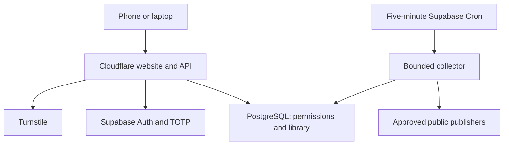
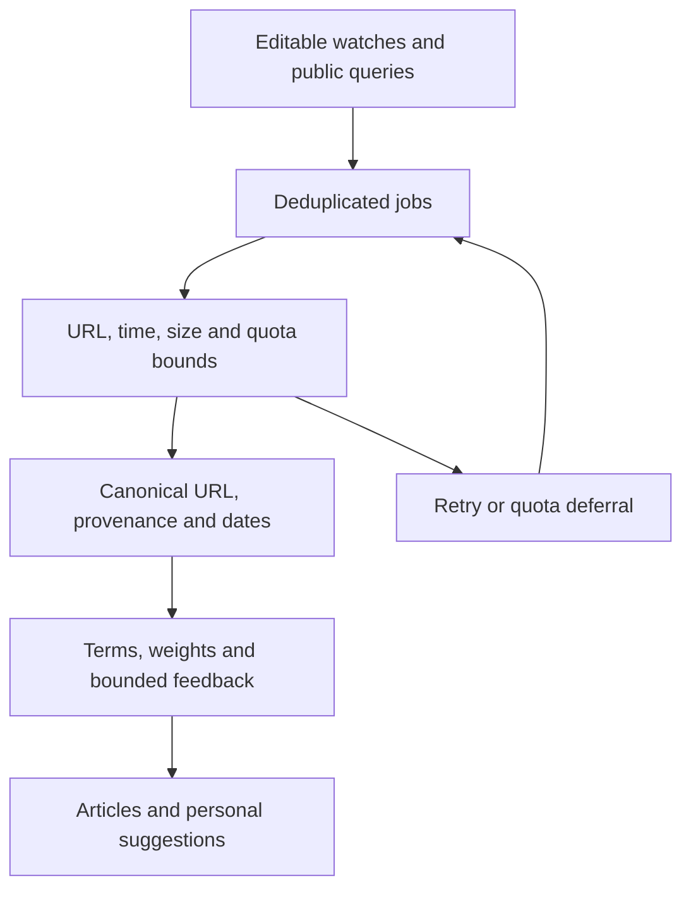
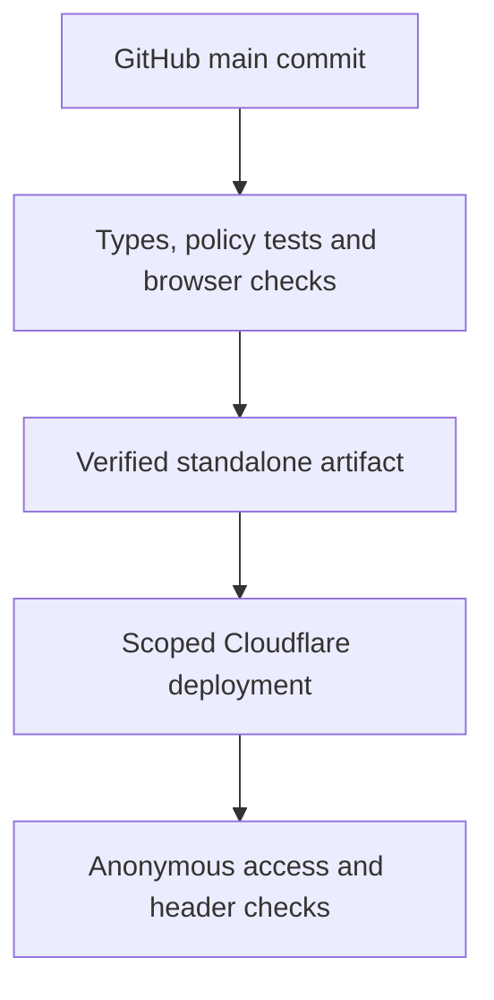

# Architecture

The Cloudflare Worker serves the authenticated website. A scheduled Supabase Edge Function collects public sources independently. PostgreSQL is the durable source of truth. No private team notes or organization LLM endpoint are needed for collection.

## Authorization

The browser receives the login shell and public JavaScript, not the private seed catalog or provider keys. `lib/server/service.ts` handles provider Auth and the authorization gateway; `lib/server/security.ts` handles origins, input bounds and encrypted sessions. Cookies are host-only, Secure, HttpOnly and SameSite. Server and database checks enforce active membership, provider-session validity, writer MFA, roles and note visibility.

Usernames map to non-deliverable internal Auth identifiers; Supabase manages password hashes. Public signup is disabled. Administrator invitations are expiring and one-time. Readers cannot modify shared content. `worker.ts` adds security headers and fresh CSP script nonces. Mutations require the configured exact origin.

The owner-only Sites publication has a separate outer gate. The standalone build omits that gate while retaining application authentication.

## Collection and relevance

Sources include release APIs, feeds, approved documentation and daily public repository queries. Fair leases prevent duplicate claims. Quota deferral does not consume a failure attempt. GitHub pagination is bounded; oversized pages use smaller batches. An ETag is committed only after required pages succeed.

Publication, discovery and detected-change times have distinct meanings. Weekly views do not invent publisher dates. Stable releases are the default; each watch can include prereleases. Personal ranking and bounded aggregate technical-tag feedback improve relevance without uploading raw chats or private notes.

## Data and deployment

Applied migrations are immutable. Reconcile live migration names before applying additions; filenames and live timestamps can differ. Imports use immutable keys. Frontend releases preserve saved links, folders, notes, accounts and source preferences.

Pull requests do not deploy. Only the production step sees the deployment token; runtime secrets remain in Cloudflare. Database and collector releases have separate rollout procedures. See [DEPLOYMENT.md](DEPLOYMENT.md).
