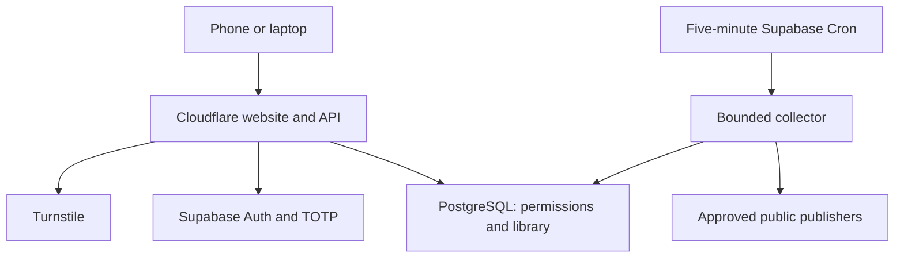
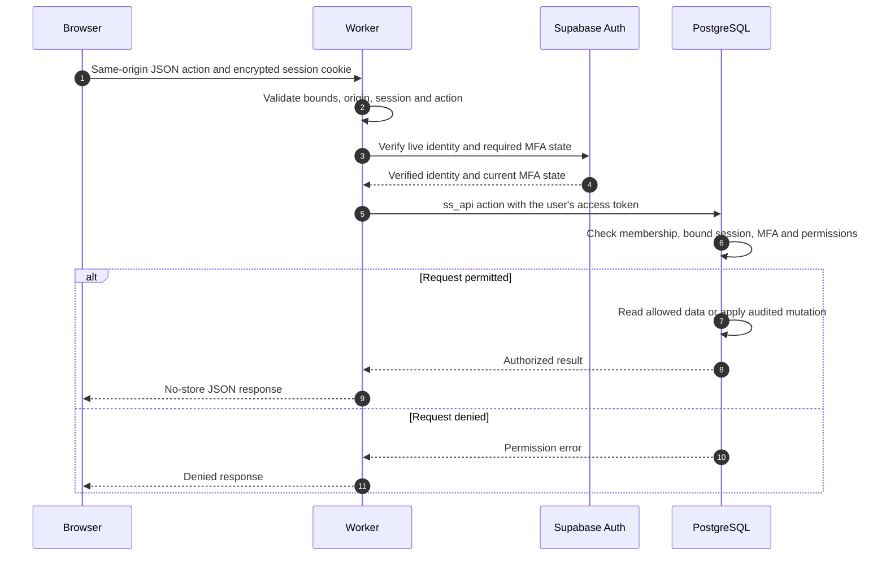
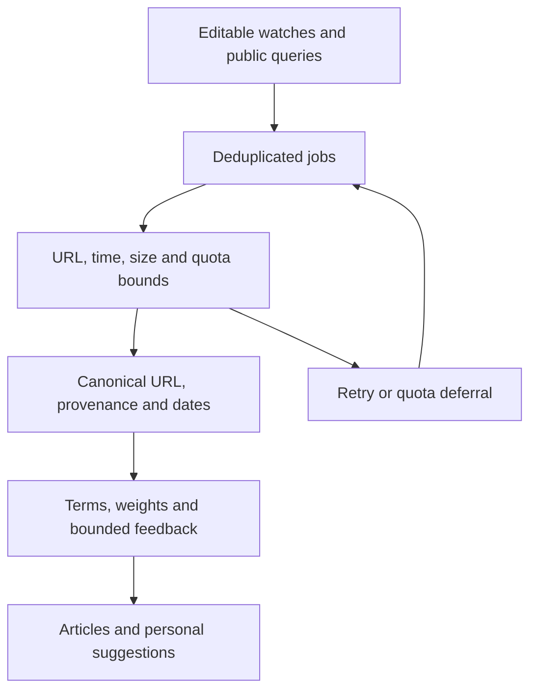
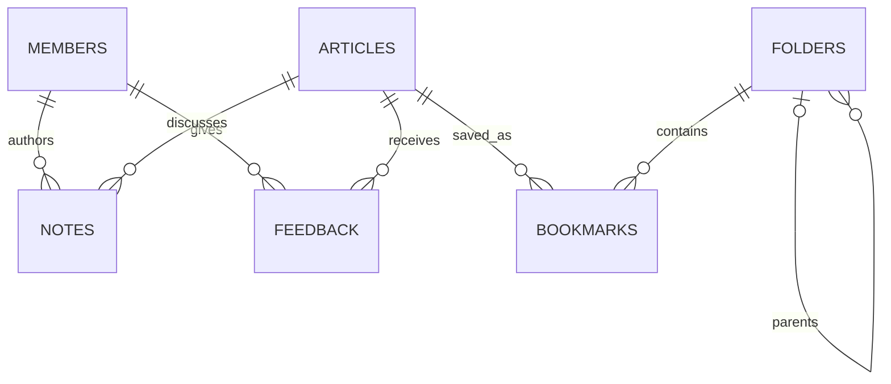
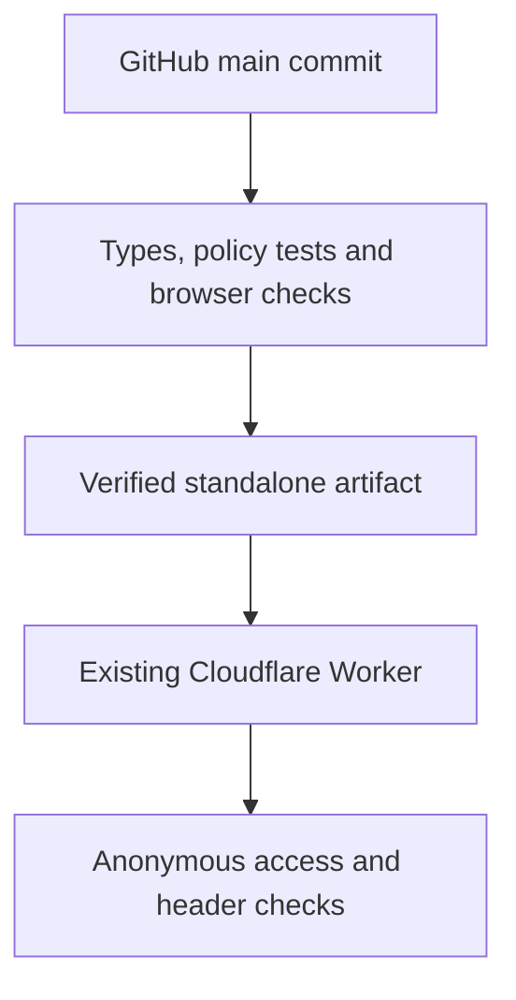

# Architecture

[Documentation hub](README.md) · [Design decisions](DESIGN.md) · [Developer onboarding](ONBOARDING.md#developers)

The Cloudflare Worker serves the authenticated website. A scheduled Supabase Edge Function collects public sources independently. PostgreSQL is the durable source of truth. No private team notes or organization LLM endpoint are needed for collection.

## Authorization

The browser receives the login shell and public JavaScript, not the private seed catalog or provider keys. `lib/server/service.ts` handles provider Auth and the authorization gateway; `lib/server/security.ts` handles origins, input bounds and encrypted sessions. Cookies are host-only, Secure, HttpOnly and SameSite. Server and database checks enforce active membership, provider-session validity, writer MFA, roles and note visibility.

Usernames map to non-deliverable internal Auth identifiers; Supabase manages password hashes. Public signup is disabled. Administrator invitations are expiring and one-time. Readers cannot modify shared content. `worker.ts` adds security headers and fresh CSP script nonces. Mutations require the configured exact origin.

The owner-only Sites publication has a separate outer gate. The standalone build omits that gate while retaining application authentication. The source repository is public; the team workspace remains invitation-only. Public login assets do not confer access to private records.

### A representative authenticated request

The central business endpoint is `POST /api/action`, using `{ action, payload }`. The server allows only enumerated actions; the database applies action-specific permissions. Read actions also use this dispatcher. Account/login/MFA routes are handled separately. Unknown actions do not become arbitrary SQL or arbitrary provider requests.

| Boundary | Enforcement | Source entry point |
| --- | --- | --- |
| Browser → Worker | Same-origin JSON, size bounds, encrypted cookie and persistent rate limits | [security.ts](../lib/server/security.ts), [service.ts](../lib/server/service.ts) |
| Worker → identity provider | Live token/user verification and current MFA checks; no trust in decoded claims alone | [service.ts](../lib/server/service.ts) |
| User token → database | Active member, bound/unrevoked session, role/MFA and note visibility | [migrations](../supabase/migrations/) |
| Collector caller → Edge Function | Dedicated collector secret; no public collection trigger | [collector](../supabase/functions/collector/index.ts) |
| Collector → publisher | Controlled host allowlist, public-address/redirect checks and bounded requests | [content.ts](../supabase/functions/_shared/content.ts), [collector](../supabase/functions/collector/index.ts) |
| Public text → UI/optional AI | Text-only rendering; bounded structured output/evidence; no model tools/private context | [workspace](../components/workspace.tsx), [collector](../supabase/functions/collector/index.ts) |

Provider service credentials remain server-side. The user-facing business RPC uses the authenticated user's token so database permission checks retain user identity. Collector/service tasks use separate privileged credentials; they do not share a browser session.

## Collection and relevance

Sources include release APIs, feeds, approved documentation and daily public repository queries. Fair leases prevent duplicate claims. Quota deferral does not consume a failure attempt. GitHub pagination is bounded; oversized pages use smaller batches. An ETag is committed only after required pages succeed.

Publication, discovery and detected-change times have distinct meanings. Weekly views do not invent publisher dates. Stable releases are the default; each watch can include prereleases. Personal ranking and bounded aggregate technical-tag feedback improve relevance without uploading raw chats or private notes.

### Collector execution and recovery

Each authorized tick enqueues due watches, performs bounded daily maintenance/discovery scheduling and leases a limited batch of jobs. Work is split across source, analysis, metadata and discovery lanes. Source definitions carry revisions so paused/removed/reconfigured watches invalidate stale queued analysis.

| Outcome | Handling |
| --- | --- |
| Successful fetch/analysis | Upsert canonical article/provenance, complete the job and update source health |
| Unchanged source | Honor valid conditional-fetch/hash state and avoid unnecessary reprocessing |
| Provider quota/throttling | Defer until a later budget window without consuming a failure attempt |
| Oversized GitHub page | Retry with a smaller page; keep pagination bounded |
| Fetch/parser failure | Record the error and retry within queue bounds |
| Partial required pagination | Keep the previous ETag until the required pages succeed |

Public repository discovery runs bounded queries over recently active, non-archived/non-fork public projects. Alternating popularity/recency broadens results, but does not guarantee repository quality or exhaustive coverage. Optional Tavily/Gemini calls are behind credentials and explicit budgets; both are currently disabled.

### Relevance has two stages

1. **At ingestion:** technical-term weights, administrator priorities/interests, release floors, content signals and bounded aggregate tag feedback produce the stored score/reason/evidence.
2. **At retrieval:** personal helpful/hidden feedback contributes a bounded topic/tag adjustment to ordering. The weekly threshold is applied to the stored base score, not an unlimited personalized override.

Reasons and excerpts explain fit. Original documents remain the authority for claims and conditions. Detailed baseline rules live in [domain.ts](../lib/domain.ts) and [relevance.ts](../supabase/functions/_shared/relevance.ts); personal retrieval rules live in the [database migrations](../supabase/migrations/).

## Domain and ownership

| Domain record | Ownership and behavior |
| --- | --- |
| `ss_members`, `ss_sessions` | Membership/role state and revocable application sessions bound to provider sessions |
| `ss_invites`, `ss_recovery` | Hashed, expiring, single-use membership/recovery claims |
| `ss_articles` | Canonical technical reference with metadata, provenance, score and date fields |
| `ss_folders`, `ss_bookmarks` | Shared hierarchy and many-to-many saved references; recursive subtree retrieval |
| `ss_notes` | Author-owned text with explicit team/private visibility; team-note replies |
| `ss_feedback` | Per-member helpful/hidden/read state; bounded ranking inputs |
| `ss_sources` | Administrator-managed watches with intervals, priority, channels, revision and health |
| `ss_jobs` | Durable collection/analysis/discovery work with lease/retry state |
| `ss_settings`, `ss_limits` | Technical profile, health/configuration and atomic usage counters |
| `ss_audit`, `ss_imports` | Audited changes and idempotent historical import records |

Source provenance and job payload references are JSON metadata, not the foreign-key relationships depicted above. A bookmarked article may belong to multiple folders. A private note does not make its article or folder private. Disabling a member invalidates access without erasing shared knowledge.

## Data and deployment

Applied migrations are immutable. Reconcile live migration names before applying additions; filenames and live timestamps can differ. Imports use immutable keys. Frontend releases preserve saved links, folders, notes, accounts and source preferences.

Pull requests do not deploy. Only the production step sees the deployment token; runtime secrets remain in Cloudflare. Database and collector releases have separate rollout procedures. See [DEPLOYMENT.md](DEPLOYMENT.md).

## Runtime and build choices

- **Application:** React/TypeScript in an App Router-style source tree, built through Vinext/Vite for the Cloudflare Worker runtime. Do not assume a conventional Node server or Vercel deployment.
- **Presentation:** Tailwind/CSS and retained UI primitives, with semantic interactions, focus management and responsive reading layouts.
- **Data:** PostgreSQL/RPC authorization rather than browser-direct table mutations. Supabase Auth provides identity/password verification.
- **Collection:** Supabase's Deno Edge Function runtime. The collector has its own type-check configuration and shared modules; a successful app build does not deploy it.
- **Two publications:** the team standalone Worker retains application authentication; the owner-only Sites fallback also has its hosting access gate. Their build modes/audiences must not be mixed.

The initial private seed catalog is server-side and checked against public client bundles. CI packages the verified standalone artifact, checks commit/target identity and preserves existing runtime variables. Runtime data, provider secrets and build artifacts are not committed.

## Verification layers

| Layer | What it checks | What it does not establish |
| --- | --- | --- |
| App/collector TypeScript | Static consistency in both source contexts | Live Deno/provider behavior |
| Security/database/collector tests | Actual migrations/RPC policies in PGlite, request/session controls, extraction and queue/ranking regressions | Independent penetration testing or a full live workload |
| Browser regressions | Synthetic authenticated UI across Chromium/Firefox/WebKit and eight viewport sizes | Real invitation/password/TOTP flows or every physical device |
| Public-asset inspection | Private seed catalog absent from public client assets | All possible future data-exposure paths |
| Production smoke | Configured Auth, disabled preview, anonymous denial, rejected cross-origin login and security headers | Human login, backup restoration or 100-user load |

For precise controls and outstanding verification, use [SECURITY.md](SECURITY.md). For commands and component conventions, use [DEVELOPMENT.md](DEVELOPMENT.md).
