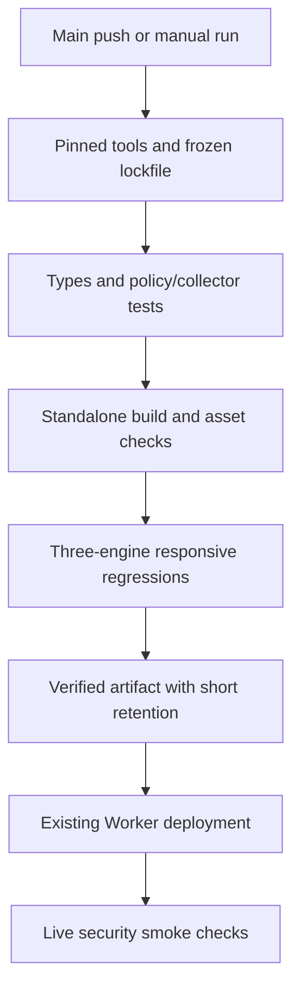

# Deployment and rollback

| Resource | Existing target |
| --- | --- |
| Team URL | https://stacksignal.stacksignal-idoheled.workers.dev |
| Cloudflare account | `49c94d7ba2a9124b3e0ddea7a329ad05` |
| Worker | `stacksignal` |
| Repository | https://github.com/Idoheled/StackSignal |
| Production branch | `main` |
| Supabase project | `plbjscbpvfozqvexmqhk` |

Never create replacement resources, bootstrap the administrator or repeat the original import. The owner-only Sites fallback retains its audience and separate runtime configuration.

## Current production setup

GitHub Actions is enabled and `production` permits only `main`. Its encrypted `CLOUDFLARE_API_TOKEN` environment secret was configured on October 11, 2026. The owner explicitly chose Worker Admin with no expiry and confirmed that Turnstile permissions were removed. Preserve this choice; credential changes are a separate coordinated operation. Provider token-policy reads are denied, so these role/expiry details are owner-confirmed rather than independently enumerated through the API.

Main requires the Quality check and reviewed PRs for ordinary contributors. Owner administrator bypass remains available for direct maintenance pushes; force pushes and branch deletion are blocked. Every eligible main push still passes the workflow's quality gate before deployment.

## Setup reference

1. Create a Cloudflare deployment token with **Editor scoped to the existing `stacksignal` Worker**, following the current [Workers role model](https://developers.cloudflare.com/workers/authorization/workers/). Routine updates need no account-wide Workers Admin, Turnstile, zone, database or bucket access. Older accounts may expose legacy Workers Scripts Edit; verify the supported scope before selecting it.
2. Add `CLOUDFLARE_API_TOKEN` in [GitHub Actions secrets](https://github.com/Idoheled/StackSignal/settings/secrets/actions). A `production` environment secret with the same name can be used instead. Never put the token in a variable, issue, file or commit. Account ID/origin are fixed, non-secret targets in the workflow.
3. Enable Actions. The workflow uses the `production` environment. Restrict it to `main` in its protection settings; keep automatic deployment without required manual approval, as requested by the owner.
4. Run **CI and Cloudflare** on `main` or rerun the initial run. Quality and Production must both succeed; a build alone does not establish deployment.
5. After the initial branch/check exists, protect `main`: require PRs and the **Quality** check, block force pushes/deletions, and review workflow/authorization changes. Retain owner recovery access. Permitted direct pushes still get validation before deployment.

The connected integration may expose source/Actions operations without secret/settings operations. In that case, the owner must configure the unavailable settings through GitHub; never claim they were configured without checking.

Standard hosted Actions on this public repository need no purchased Actions plan. Keep spending limits at zero; do not enable larger paid runners or upgrade Workers/Supabase. Private repositories have finite included CI quotas.

## Pipeline



Actions are pinned to full commit SHAs; Dependabot proposes updates. PRs have read-only repository permissions and no deployment token. Production downloads its own run's verified artifact and validates repository/branch/account/Worker. Superseded commits are skipped to avoid deploying older code. Deployments are serialized and are not canceled mid-upload.

Only the deployment step sees the Cloudflare token. `--keep-vars` preserves configured variables; runtime secrets remain in Cloudflare. CI never uploads `.env.setup`, database/session keys or the collector secret. Secret rotation is a separate deliberate operation.

Smoke checks verify configured Auth, disabled preview, anonymous denial, same-origin mutations and security headers. Human login/MFA and physical-device checks remain separate. A failed smoke step does not automatically roll back the deployed Worker.

## Database and collector

Frontend CI does not migrate/reset the database, bootstrap users or deploy Supabase functions. Review migration names against live history, back up data and apply only the new migration/function version. Prefer additive schema changes compatible with the previous frontend. Record outcomes in `OPERATIONS.md`.

## Rollback

Identify the last good Cloudflare version and inspect secret/schema changes. Roll back through Cloudflare's supported deployment history, or make a new GitHub revert commit and let CI deploy it. Run smoke checks and verify the affected authenticated workflow. Record the cause/recovery.

Worker rollback does not restore database data, undo migrations or revert collector writes. Do not reset/reimport data to recover a frontend.

## Manual fallback

For an authorized operator with a scoped token/account ID in the process environment:

```sh
pnpm install --frozen-lockfile
pnpm typecheck
pnpm typecheck:collector
pnpm test
pnpm build:standalone
node scripts/verify-client-boundary.mjs
pnpm deploy:cloudflare
pnpm smoke:production
```

Browser checks should also pass on a supported runner. Keep secrets out of argv/logs; never deploy a normal Sites build to the standalone Worker.

## Saved discovery preferences

Administrator mode and limits are stored in Supabase `ss_settings`, not the frontend bundle. Worker/collector redeployment does not run seed imports, bootstrap accounts or migrations, and preserves the saved Apply/Compare/Off selection. GitHub deployment retains runtime secrets and does not reset the persistent attempt ledger. Fresh independent installations remain opt-in with provider budgets at zero. Never rerun the team seed import to change live discovery preferences.
