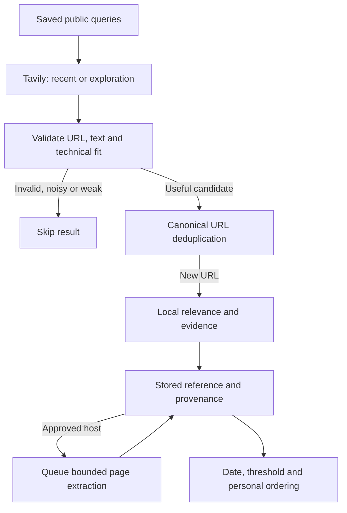

# How discovery and relevance work

[Documentation hub](README.md) · [Web-search operations](WEB_DISCOVERY.md) · [Architecture](ARCHITECTURE.md) · [Coverage](COVERAGE.md)

StackSignal separates **finding material**, **judging technical fit**, and **ordering your reading list**. Tavily searches the web; StackSignal applies its own rules and feedback. The match number is a relevance score, not a probability that an article is correct, useful or compatible with your environment.

## Current configuration

As verified on October 11, 2026, the deployed workspace has active Tavily search, 20 web queries, eight GitHub project-discovery queries and 61 active source watches. The first web sweep completed all 20 queries and stored 86 new references. Gemini evaluation is active in Apply mode using `gemini-flash-latest` on a confirmed Free-tier API project; the first assessment resolved to `gemini-3.8-flash` and preserved the feed score. These are dated observations, not counts that every installation should have; check Administration → Health for current state.

A separate installation starts with provider budgets at zero. The original seed import and its eight historical web queries do not overwrite the existing workspace's live profile; do not rerun the import to configure discovery. Prepared web queries are in [source-config.ts](../lib/source-config.ts); the deployed profile is held in PostgreSQL and edited through Administration → Coverage.

## 1. Where candidates come from

| Lane | Engine | What chooses the work | What it finds |
| --- | --- | --- | --- |
| Web discovery | Tavily Search REST API | Administrator-authored web queries | Documentation, articles, papers, tools, projects and news across public domains |
| New GitHub projects | GitHub repository Search API | Separate administrator-authored repository queries | Public, non-fork, non-archived repositories pushed within the past 30 days |
| Followed dependencies | GitHub release/issue/PR APIs | Explicit watches, interval, priority and channel | Releases and changes for selected projects; stable releases by default |
| Publications and documentation | RSS/Atom and approved-host HTTP fetching | Explicit feed/page watches | New feed entries and meaningful changes to watched pages |
| Team submissions | StackSignal submission and supported metadata extraction | A member supplies a missed public link | A reference to save and review; optionally a helpful-feedback signal |

The website reads stored results. It does not initiate a new paid search for every visitor or every page refresh. Supabase Cron ticks every five minutes and the collector leases at most eight jobs per tick. Watch intervals, queue load and provider limits determine when each result arrives.

GitHub project search alternates sorting by activity and stars on successive UTC days, returning at most six results per query. Those signals widen the radar; they do not certify repository quality. Search engines and RSS feeds are distinct from the optional Gemini classifier.

## 2. What the web searches are based on

The initial technical context was distilled from the team's supplied public links and conversations: serving, cache/memory, networking, OpenShift/operators, placement, hardware/provisioning, routing, benchmarks and emerging research. The collector now reads a **saved list of public technical queries**, not the original chats.

Examples from the active 20-query profile:

| Goal | Query |
| --- | --- |
| Serving lifecycle | `KServe llm-d distributed inference deployment release notes` |
| Cache and data movement | `NVIDIA Dynamo NIXL KV cache offloading performance` |
| Lossless networking | `RoCE PFC ECN congestion lossless fabric benchmark` |
| GPU placement | `Kubernetes KAI NUMA GPU topology aware scheduling` |
| Discover unfamiliar work | `AI inference runtime open source new tools research` |
| Upgrade risk | `LLM serving security vulnerability breaking changes` |

Administrators can change any query without a deployment. Interests and topic priorities affect local matching; changing them does **not** automatically rewrite the web queries. Likewise, following a repository creates a release watch, not a new web-search query.

For 20 queries, each daily sweep schedules **15 recent-week searches and five exploration searches**. The exploration group rotates: each query searches without a time window once every four UTC days. Exploration can find older but newly useful material. It is not an AI planner inventing new topics; administrators still control the query list.

Only query text and fixed search options go to Tavily. The collector does not send chats, notes, usernames, private infrastructure identifiers or feedback explanations. Administrators should keep queries public and technical, since query text is shared with the search provider.

## 3. How a web result earns a place

Before storing a search result, the collector checks typed fields, bounded lengths, canonical public HTTPS identity and at least 60 characters of usable excerpt. It rejects credentialed/private URLs, obvious portfolio/hiring/finance/promotional patterns and technical relevance below 45. Tracking variants of an already stored URL do not create another reference.

Substantive exploration snippets may be retained below the normal rules threshold for semantic sampling; they remain out of the default feed unless promoted. The provider's relevance score is not copied into the card's match number. StackSignal computes its own score from the public title and excerpt; a later approved-host fetch can refresh metadata and ranking with page text. Unknown domains remain searchable references but are not automatically fetched or added to the approved-host list.

A search excerpt retains provider, query, search window, hostname and date provenance. **Web search result** means the search provider returned it. **Link checked** means StackSignal subsequently fetched the destination. Neither label means its benchmark or technical claims were validated. Provider-reported dates remain distinguished from publisher-extracted dates; unknown dates stay unknown.

## 4. Exact stored-score rules

The baseline classifier is deterministic; optional Gemini comparison mode leaves these scores unchanged. See [basicRelevance](../lib/domain.ts), [relevance.ts](../supabase/functions/_shared/relevance.ts) and [web-discovery.ts](../supabase/functions/_shared/web-discovery.ts).

| Stage | Current rule |
| --- | --- |
| Topic terms | Each recognized term contributes once within its topic: 16 points for a concrete term, three for a broad term such as `nvidia`, `llm`, `operator`, `latency` or `benchmark` |
| Topic priority | Add the administrator's priority for that topic, bounded to −20…+20; choose the topic with the greatest weighted total |
| Base score | With any recognized terms: `clamp(30 + best topic total, 15, 95)`; with none: 15 |
| Team interests | Up to +9: three points per matching saved interest, considering at most four matches |
| Headline specificity | +5 when the title alone has a base score of at least 46 |
| Practical signals | +4 when the title/body has a security, compatibility, performance or implementation signal and the base score is at least 46; this is one boost, not four boosts |
| Noise discounts | −35 for specified investment/finance headline patterns; −15 for specified sponsored/registration/promotion headline patterns |
| Source/watch intent | Followed-release floor of 80, or 88 for a core watch, before feedback; other sufficiently relevant items get +5 for core priority or −3 for exploration priority |
| Shared feedback | Sum the matching technical-tag weights, bounded to −8…+8 |
| Final stored score | Round and clamp to 0…98 |

Topic matching uses word boundaries for terms shorter than four characters and substring matching for longer terms. Saved interests of four characters or fewer use word boundaries. This prevents some acronym collisions, but the classifier does not understand every synonym or the full meaning of a sentence.

**Worked example:** title `Understanding Dynamo`, body `A detailed description of distributed inference and cache behavior.`, Inference priority +10 and `Dynamo` among saved interests. The concrete terms `dynamo` and `inference` contribute 32; priority adds 10; the base is 30 + 42 = 72. The matching interest adds three and the specific title adds five, giving **80** with no other signals or feedback. This synthetic example is calculated using the current functions, not a provider score.

A score of 98 can mean that a title/excerpt contains many relevant terms. It does not mean 98% certainty, publication credibility or verified performance. Saturation and keyword-heavy content are known limits of these rules.

## 5. What each person sees

The configured minimum score is currently **55**, editable from 45 to 85. Weekly, radar and documentation-update views apply that threshold to the stored score. Followed-release alerts bypass this generic threshold because the administrator selected the dependency. Date/view/type filters and personal hidden state still apply. **All discoveries** bypasses the weekly date/minimum-score gates for stored items; it cannot restore a candidate that was never ingested.

The card displays the **stored score**. When sorting by relevance, the database adds a separate personal ordering adjustment: +2 per helpful item, otherwise −2 per hidden item, when that prior item shares a topic or tag; the total is capped at −12…+12. That adjustment changes order, not the number printed on the card. Recency sorting uses dates instead.

Shared tag learning uses active members' helpful/hidden feedback from the last 90 days. Each tag's sum is capped at −4…+4, and the ingestion contribution is capped at −8…+8. Feedback affects future/reprocessed ingestion and personal retrieval; it does not automatically rescore every historical article after each click.

Saving or reading alone does not train the classifier. A submitted missed link can record helpful feedback when its teaching option is enabled. Comments and private notes remain knowledge for people, not model-training data. Feedback does not automatically create queries, subscribe to a new domain or train an external LLM.

## 6. Control and troubleshooting

| Symptom | First adjustment |
| --- | --- |
| Missing a topic | Add/refine a web query; add a feed or release watch for an important dependency |
| Too many tangential results | Narrow the query, adjust topic priorities/interests or raise the minimum score |
| Interesting unfamiliar material is absent | Retain broad exploration queries and inspect New to radar / All discoveries |
| A result is personally irrelevant | Use Not relevant after confirmation; restore it through Hidden signals if needed |
| No recent web discoveries | Check Health for key readiness, last success/error and quota deferral; check the monthly ceiling |
| A useful article has no weekly entry | Check its publication date; an undated/older discovery belongs in New to radar rather than a fabricated publication week |

Tavily uses basic searches, at most eight results per response, a hard 24-request UTC-day cap and a configured monthly cap no greater than 800. The current workspace uses 800. Reservations include failed attempts; other consumers of the Tavily account are outside these app limits. See [WEB_DISCOVERY.md](WEB_DISCOVERY.md) for secret configuration and provider billing boundaries.

The [conservative Gemini evaluator](GEMINI_EVALUATION.md) is a separate optional layer: Flash Latest samples strong, borderline and unfamiliar discoveries with an atomic four-attempt rolling 24-hour cap, 100 monthly cap and one-hour spacing. Comparison mode preserves scores; Apply mode blends only confident, evidenced assessments. A free-tier API key is required. Enabling Tavily alone never enables Gemini.

## What “I don't know what I don't know” means here

Explicit watches cover known dependencies. Open-web queries, new-project search and rotating exploration broaden discovery beyond the watchlist. This is useful coverage, not autonomous exhaustive research: query design, indexing, finite result counts and heuristic ranking all leave gaps. The current product has no automatic research planner, embedding-based semantic ranker or independent claim-verification engine.

Keep source evidence visible, use feedback, and revise coverage as the team's stack evolves. Every useful discovery still deserves a human applicability check before production use.
