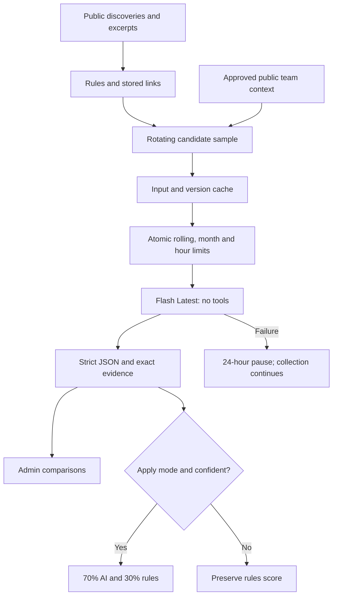

# Conservative semantic evaluation

Gemini evaluates a small sample of public discoveries against the team's engineering mission. Tavily still finds links; Gemini does not search, browse, execute tools or validate performance claims. Normal collection continues when evaluation is paused or unavailable.

The evaluator uses **`gemini-flash-latest`**, as requested by the owner. Google moves this alias to newer Flash releases automatically, including potentially preview or experimental releases. This follows future releases without editing the model ID. Google documents free input/output for the current Gemini 3.8 Flash model as checked on October 11, 2026; the actual resolved version is recorded from each successful response and shown in Administration → Health.

**Keep the Google API project on the Free tier for zero spend.** The application cannot infer billing status or pricing from an API key. A future alias change is not a promise of permanent free availability: unavailable models, exhausted quota or incompatible responses pause evaluation for 24 hours and leave discovery running. There is no paid or alternate-model fallback. Enabling paid billing on that project would remove this zero-spend protection, even with these small request caps. A consumer subscription does not establish API entitlement.

## Operating modes

| Mode | Behavior |
| --- | --- |
| Off | No generation requests |
| Compare only (`shadow`) | Store the AI assessment and show recent comparisons in Administration → Health; feed scores stay unchanged |
| Apply (`rerank`) | For future successful, high-confidence evaluations with sufficient evidence, blend 70% semantic score and 30% rules score; retain rules for uncertain results |

Separate installations should begin with comparison mode. The owner has enabled Apply in the existing workspace. The saved mode and ceilings live in PostgreSQL and survive frontend and collector redeployments; deployment does not reseed or overwrite them. Future administrator changes to Off or Compare are also preserved. Changing mode does not bulk rerank existing cached results or trigger a paid re-evaluation of the library. Release alerts are excluded from sampling and keep their existing guarantees. No evaluation deletes or hides a record.

## Hard usage controls

| Control | Limit |
| --- | --- |
| Generation attempts | At most 4 in a **rolling 24-hour window** |
| Monthly attempts | At most 100 per UTC calendar month |
| Spacing | At least 24 hours divided by the configured daily ceiling, and longer when needed to spread remaining monthly attempts |
| Per collector tick | At most one generation request |
| Public source excerpt | 6,000 UTF-8 bytes, plus a title of at most 500 bytes |
| Output | At most 650 generation tokens, low thinking |
| Provider/validation failure | Keep rules; pause for 24 hours; no immediate retry |
| Input reuse | Cache by public input, public team context, evaluator version and model |

Administrators can lower the daily/monthly ceilings or pause evaluation at any time. The private attempt ledger reserves calls atomically under a Postgres transaction lock, so concurrent ticks cannot bypass limits. Failures and interrupted runs still consume reservations. Identical article/input claims remain in the ledger for up to 90 days; valid cached results avoid repeat calls even beyond that period. Removing an article does not erase its usage reservation. Generation caps cover this application, not other clients sharing your Google project. Health reports attempts, latest provider state and the latest successful comparisons; token usage is recorded with each successful evaluation.

The collector paces remaining attempts across the rest of the UTC month. Its next opportunity is the previous attempt plus the larger of: one hour, 24 hours divided by the daily ceiling, or the time from that attempt to month-end divided by remaining monthly attempts. A previous-month attempt contributes only the daily spacing. This avoids routinely consuming the entire monthly allowance early, without a catch-up burst. The independent atomic ledger still enforces all hard caps and includes failures. Visitor count, browsing, deployments and refreshing the website do not reset budgets or cause Gemini requests.

These limits are **StackSignal limits**, not a measurement of Google's quota. Google enforces project/model-specific RPM, TPM and RPD, with RPD resetting at midnight Pacific time; actual capacity can change. Check AI Studio's active quota view and share the values to assess headroom. There is no guarantee of unlimited capacity or zero 429 responses from a changing alias. Keep the API project Free: unavailable capacity does not justify enabling billing.

## Sampling and evaluation

The sweep takes the oldest 50 pending, non-deleted records with collector-captured public input. There is no seven-day expiry for this queue. Attempt counts rotate preference between strong rules matches, borderline matches, exploration and strong matches, so lane rotation does not depend on the scheduled hour. A preferred lane falls back to available candidates. Reviewed inputs are retained as cached assessments; changed public source input clears the old assessment and returns to eligibility. Failed inputs are flagged for inspection and excluded from automatic retries until their public input changes or an operator resolves them. Releases and records without public input are excluded.

Administration → Health shows eligible, reviewed, pending and failed counts, refreshed by the collector. Counts are dated snapshots, not guaranteed simultaneous totals. All discoveries continue through normal rules-based ranking and release monitoring while AI waits. A growing arrival rate can exceed the small AI budget: durable queuing prevents age-based loss, but cannot guarantee timely AI review of every link or complete internet coverage. With 82 eligible records and one reviewed at activation, the backlog alone would require at least 21 daily-cap days, even with no further arrivals or failures; monthly pacing may take longer.

Exploration search results with a substantive excerpt (at least 120 characters) may be retained even with weak keyword overlap, after URL and noise checks. They remain below the feed threshold unless a confident semantic evaluation promotes them in Apply mode. This gives unfamiliar approaches a route into consideration without widening automatic destination-fetch permissions.

The request uses `LOW` thinking: the current Flash model rejects the Lite model's `MINIMAL` setting. The 650-token generation cap includes any thinking budget consumed by the provider; incomplete output is rejected instead of retried. Alias changes can affect response compatibility or quality. Cached assessments remain historical: model upgrades do not re-evaluate the entire library.

The response separates semantic relevance, engineering depth, confidence and insufficient evidence. It includes a grounded summary, why it matters, a possible next action and an exact quote from the supplied excerpt. The quote is checked locally, along with strict field types, ranges, lengths and a completed response. Structured output is not proof that the model's judgment is correct.

## Privacy and trust boundaries

- Inputs come from public search snippets, approved publisher excerpts and public repository metadata. Existing confirmed Tavily snippets can seed initial comparisons; imported chats and manual submissions without public extraction cannot.
- Only the fixed engineering mission, stack, recognized public interest terms and numeric topic priorities are sent. Arbitrary free-form profile content, custom queries, usernames, notes, comments, raw chats and internal topology are excluded.
- Source text is untrusted. No tools or model-selected network fetches are provided. A search snippet is labeled as a snippet, never a full-page review.
- The Gemini key stays in Supabase function secrets. It is not a browser variable, Cloudflare frontend secret, repository file or GitHub Actions secret.
- Google's free-tier terms may permit use of submitted data to improve products. A free API project is required for strict zero spend; linking paid billing is outside this setup.

## Activation

1. Open [Google AI Studio API keys](https://aistudio.google.com/api-keys). Use a project marked **Free** and verify the available quota for `gemini-flash-latest` in its rate-limit view. Do not enable paid billing for zero spend.
2. Set `GEMINI_API_KEY` in the Supabase project's **Edge Functions → Secrets**. Do not put it in a URL or frontend configuration. Existing `GEMINI_MODEL` secrets are ignored; the Flash Latest alias is fixed in code.
3. In Administration → Coverage choose **Compare only**, daily ceiling **4** (or lower) and monthly ceiling **100** (or lower). Either ceiling zero disables requests.
4. Verify Health and the first real comparison. An API key cannot establish billing status by itself; confirm the project tier before activation.
5. Assess a sample over several days before opting into Apply mode. Narrow free-tier quotas, 429 responses, invalid keys and unavailable models pause evaluation and preserve collection.

## Architecture

Implementation: [evaluation helpers](../supabase/functions/_shared/evaluation.ts), [collector](../supabase/functions/collector/index.ts), [private reservations and permissions](../supabase/migrations/20261011104500_conservative_evaluation.sql). See [discovery rules](DISCOVERY.md), [architecture](ARCHITECTURE.md) and [security](SECURITY.md).

Provider references: [models](https://ai.google.dev/gemini-api/docs/models), [pricing](https://ai.google.dev/gemini-api/docs/pricing), [rate limits](https://ai.google.dev/gemini-api/docs/rate-limits), [generation API](https://ai.google.dev/api/generate-content), [terms](https://ai.google.dev/gemini-api/terms).
