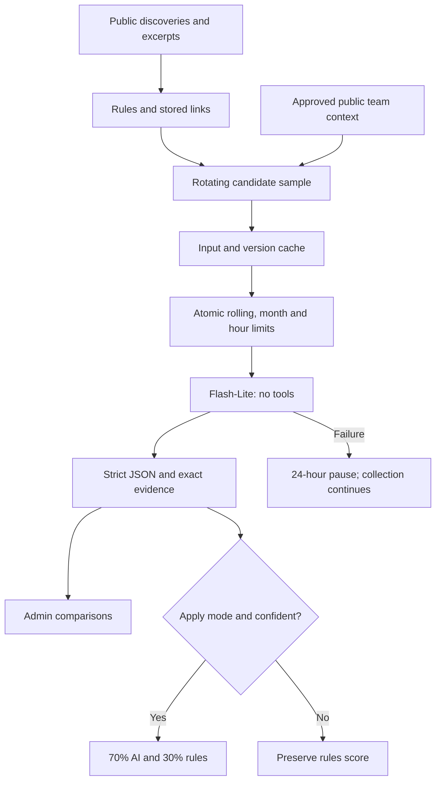

# Conservative semantic evaluation

Gemini evaluates a small sample of public discoveries against the team's engineering mission. Tavily still finds links; Gemini does not search, browse, execute tools or validate performance claims. Normal collection continues when evaluation is paused or unavailable.

The implementation pins **`gemini-3.5-flash-lite`**, a stable model with a documented free tier as checked on October 11, 2026. Actual availability and quota depend on the API project. There is no automatic fallback to a larger model and no assumption that a consumer subscription includes unlimited API calls.

## Operating modes

| Mode | Behavior |
| --- | --- |
| Off | No generation requests |
| Compare only (`shadow`) | Store the AI assessment and show recent comparisons in Administration → Health; feed scores stay unchanged |
| Apply (`rerank`) | For future successful, high-confidence evaluations with sufficient evidence, blend 70% semantic score and 30% rules score; retain rules for uncertain results |

Begin with comparison mode. Review the reasons, supporting excerpts and disagreements before enabling ranking changes in Administration → Coverage. Changing mode does not bulk rerank existing cached results or trigger a paid re-evaluation of the library. Release alerts are excluded from sampling and keep their existing guarantees. No evaluation deletes or hides a record.

## Hard usage controls

| Control | Limit |
| --- | --- |
| Generation attempts | At most 4 in a **rolling 24-hour window** |
| Monthly attempts | At most 100 per UTC calendar month |
| Spacing | At least one hour between attempts across all collector runs |
| Per collector tick | At most one generation request |
| Public source excerpt | 6,000 UTF-8 bytes, plus a title of at most 500 bytes |
| Output | At most 650 model output tokens, minimal thinking |
| Provider/validation failure | Keep rules; pause for 24 hours; no immediate retry |
| Input reuse | Cache by public input, public team context, evaluator version and model |

Administrators can lower the daily/monthly ceilings or pause evaluation at any time. The private attempt ledger reserves calls atomically under a Postgres transaction lock, so concurrent ticks cannot bypass limits. Failures and interrupted runs still consume reservations. Identical article/input claims remain in the ledger for up to 90 days; valid cached results avoid repeat calls even beyond that period. Removing an article does not erase its usage reservation. Generation caps cover this application, not other clients sharing your Google project. Health reports attempts, latest provider state and the latest successful comparisons; token usage is recorded with each successful evaluation.

A 100-attempt monthly ceiling may pause evaluation before the end of a month if the full four attempts are used daily. There is no catch-up burst. Visitor count, library browsing and refreshing the website do not cause Gemini requests.

## Sampling and evaluation

The sweep considers up to 200 newest non-deleted discoveries from the last seven days that have collector-captured public input. UTC hours rotate preference between strong rules matches, borderline matches, exploration and strong matches. A preferred lane falls back to available eligible candidates. Existing cached/claimed inputs are skipped. This is conservative sampling, not evaluation of every result or exhaustive research.

Exploration search results with a substantive excerpt (at least 120 characters) may be retained even with weak keyword overlap, after URL and noise checks. They remain below the feed threshold unless a confident semantic evaluation promotes them in Apply mode. This gives unfamiliar approaches a route into consideration without widening automatic destination-fetch permissions.

The response separates semantic relevance, engineering depth, confidence and insufficient evidence. It includes a grounded summary, why it matters, a possible next action and an exact quote from the supplied excerpt. The quote is checked locally, along with strict field types, ranges, lengths and a completed response. Structured output is not proof that the model's judgment is correct.

## Privacy and trust boundaries

- Inputs come from public search snippets, approved publisher excerpts and public repository metadata. Existing confirmed Tavily snippets can seed initial comparisons; imported chats and manual submissions without public extraction cannot.
- Only the fixed engineering mission, stack, recognized public interest terms and numeric topic priorities are sent. Arbitrary free-form profile content, custom queries, usernames, notes, comments, raw chats and internal topology are excluded.
- Source text is untrusted. No tools or model-selected network fetches are provided. A search snippet is labeled as a snippet, never a full-page review.
- The Gemini key stays in Supabase function secrets. It is not a browser variable, Cloudflare frontend secret, repository file or GitHub Actions secret.
- Google's free-tier terms may permit use of submitted data to improve products. A free API project is required for strict zero spend; linking paid billing is outside this setup.

## Activation

1. Open [Google AI Studio API keys](https://aistudio.google.com/api-keys). Use a project marked **Free** and verify the available quota for `gemini-3.5-flash-lite` in its rate-limit view. Do not enable paid billing for zero spend.
2. Set `GEMINI_API_KEY` in the Supabase project's **Edge Functions → Secrets**. Do not put it in a URL or frontend configuration. Existing `GEMINI_MODEL` secrets are ignored; the model is pinned in code.
3. In Administration → Coverage choose **Compare only**, daily ceiling **4** (or lower) and monthly ceiling **100** (or lower). Either ceiling zero disables requests.
4. Verify Health and the first real comparison. An API key cannot establish billing status by itself; confirm the project tier before activation.
5. Assess a sample over several days before opting into Apply mode. Narrow free-tier quotas, 429 responses, invalid keys and unavailable models pause evaluation and preserve collection.

## Architecture

Implementation: [evaluation helpers](../supabase/functions/_shared/evaluation.ts), [collector](../supabase/functions/collector/index.ts), [private reservations and permissions](../supabase/migrations/20261011104500_conservative_evaluation.sql). See [discovery rules](DISCOVERY.md), [architecture](ARCHITECTURE.md) and [security](SECURITY.md).

Provider references: [models](https://ai.google.dev/gemini-api/docs/models/gemini-3.5-flash-lite), [pricing](https://ai.google.dev/gemini-api/docs/pricing), [rate limits](https://ai.google.dev/gemini-api/docs/rate-limits), [generation API](https://ai.google.dev/api/generate-content), [terms](https://ai.google.dev/gemini-api/terms).
