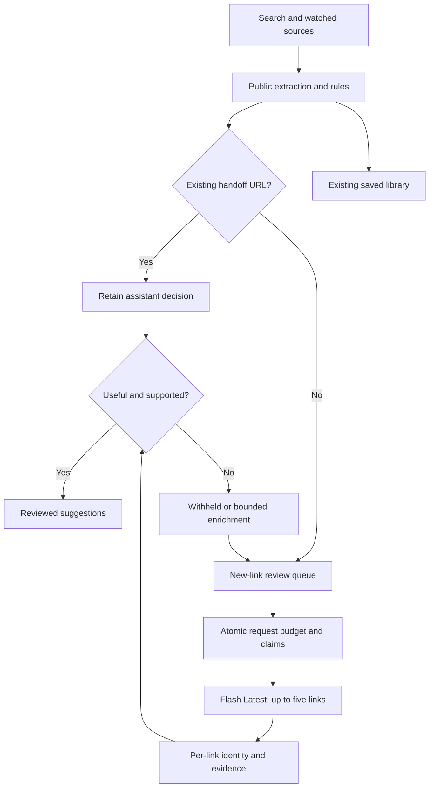

# Durable reviewed discovery

StackSignal uses Tavily, public GitHub discovery and source watches to find links. The existing October 11 collection was reviewed by the assistant. Gemini **evaluates newly discovered URLs using public material captured by the collector**; it is not the search engine or an independent fact checker.

## Existing collection and handoff

The handoff froze 717 existing URLs, including URLs in pending collection jobs, at `2026-10-11T17:06:30.77093Z`. All 717 received assistant decisions: 336 useful, 272 not selected and 109 insufficient evidence. These are dated counts, not a promise that every reference is useful or accessible. Public excerpts, repository metadata/README text and release bodies supplied the evidence. GPU benchmarks and third-party code were not executed as part of the relevance review.

The database excludes this cohort at both Gemini candidate selection and atomic reservation. GitHub owner/repository casing does not create a new identity; release-tag casing is preserved. Old queued jobs and redeployments cannot send these links back to Gemini. A genuinely new release URL is eligible. No historical import is reapplied, and no provider quota ledger is reset.

Service-only `ss_apply_assistant_reviews` validates explicit decisions, exact source evidence and every acceptance gate before storing a reviewer/date and reviewed-content snapshot. An immutable private review-history table retains the decision. Collector refreshes preserve completed reviews; changed public text is flagged against the original snapshot. Reviewed or cohort articles are excluded from routine 90-day cleanup. Existing bookmarks, notes, feedback and read states remain attached to their original article IDs.

## What members see

GitHub links must first pass the [current repository maintenance policy](REPOSITORY_DISCOVERY.md). The same gate is enforced at candidate selection, atomic reservation and feed read. This does not certify code security or peer review.

Every suggested-feed mode, including releases and All reviewed, admits only completed, useful assessments with medium/high confidence, practical/advanced depth, an exact source quote and an AI score meeting the administrator's minimum score. Pending links, low-confidence judgments, introductory/tangential results, insufficient evidence and errors stay out of suggestions. Saved library links remain accessible, including references members saved before this policy. Library titles and notes are not submitted to Google.

This week retains the publisher's seven-day date window. New to radar uses the assessment date, so a backlogged or undated reference can surface when its review completes without inventing a publication date. All reviewed has no age cutoff. Followed-release alerts and unread counts require review too, and respect prerelease settings.

Every discovery mode shows at most one latest approved, channel-eligible release per project. The database selects it before search, personal read/dismiss state, score sorting or pagination; weekly and unread-release counts use the same selection. Older maintenance-branch patches cannot displace a newer comparable version just because their score or publication date is higher. Nonversion tag schemes use publisher time. GitHub repository casing and legacy source labels do not split canonical project identity; official OpenShift streams share one project and honor preview opt-in, including in All reviewed. Documentation and PRs remain independent items.

An older release saved by any member remains in the shared library with its review and read state. Saving does not put superseded releases back in discovery. Existing review history and collection rows are retained, and pending/rejected new versions cannot replace the latest approved release. See [discovery selection rules](DISCOVERY.md#5-what-each-person-sees).

Apply mode uses the existing 70% AI / 30% rules blend for high-confidence Gemini assessments; medium-confidence assessments preserve stored rules scores. Admission uses the assessment decision and score independently, so useful unfamiliar tools can enter despite weak keyword overlap. Assistant reviews display and rank by their explicit assessment score. Cards identify the assistant or Gemini as reviewer; details retain the review date and flag subsequent content changes. Evaluate without changing ranking still gates suggestions; Off pauses new evaluations but retains completed reviews.

## Request and coverage budgets

| Control | Enforcement |
| --- | --- |
| Model | `gemini-flash-latest`; last resolved model recorded in Health |
| Batch size | Up to twelve links in one synchronous `generateContent` request |
| Daily requests | At most 16 in a rolling 24 hours **and** the Pacific calendar day |
| Monthly requests | At most 496 per UTC calendar month; administrator may lower it |
| Spacing | At least five minutes globally, one request per independent evaluation tick |
| Public source input | At most 6,000 UTF-8 bytes of text and 500 bytes of title per link |
| Output | 900 generation tokens per link, at most 10,800 per request; LOW thinking |
| Timeout | 90 seconds; no immediate provider retries |
| Input retries | Five-minute in-flight lease; transient/configuration failures keep a durable retry time; three invalid-output failures require review |
| Provider errors | HTTP 408/429/5xx/network failures: exponential backoff with jitter (5 minutes to 2 hours), honoring Retry-After; auth/configuration: 24 hours; failures consume slots |
| Malformed batch | One-hour cooldown; smaller subsequent batches isolate invalid output |

The owner's October 11, 2026 AI Studio screenshots show **5 RPM, 250,000 input TPM and 20 RPD** for Gemini 3.8 Flash on a Free-tier project. Sixteen daily requests leave four requests of daily headroom. These quotas are shared by every client in the Google project and can change when the latest alias changes. Keep the project dedicated to StackSignal and on the Free tier. Application ceilings cannot prove or control the project's billing tier. There is no paid fallback or alternate-model retry.

**Sixteen requests × twelve links gives an upper bound of 192 link assessments/day, not a throughput guarantee.** Small/failed batches, insufficient excerpts, unavailable sources and arrivals above capacity can cause delays. A monthly request ceiling is an application safeguard, not a Google monthly free allowance. Do not claim exhaustive discovery or instant review regardless of volume.

## Durable queue and extraction

The sweep loads the oldest/priority window of 200 eligible new-link public inputs **after excluding the frozen cohort and filtering GitHub repository health**, rotates preference among strong/borderline/exploration lanes and submits up to twelve atomically reserved inputs. Already leased inputs are skipped within the window, so an interrupted request does not unnecessarily block all other work. There is no seven-day queue expiry.

New references without public text enter a separate bounded extraction queue: up to eight records per tick, once per record, only for approved public hosts. Completed assistant reviews skip this bootstrap extraction. PDFs and unsupported hosts remain visible in administrator new-link coverage as missing public input. Public GitHub repository extraction uses API metadata and a bounded public README when available. Imported chat text, private notes and arbitrary user titles are never evaluation inputs.

A new-link insufficient-evidence search snippet may request one richer approved-host fetch. Completed decisions are retained when captured public text changes, with a content-change marker and the original reviewed snapshot. Metadata-only changes also preserve the assessment without another Gemini call. Transport failures remain queued beyond three attempts. Three invalid-output failures require inspection. No model-selected URL expands the fetch allowlist.

## Validation and concurrency

Each batch response binds an assessment to a supplied article id. Unknown or duplicate ids reject the whole response. Missing results and per-item validation failures are withheld while independently valid items can be saved. Each evidence quote must occur in **that item's** excerpt, preventing evidence from another batch member from being accepted. A complete STOP response, exact field set, types, enum values, score bounds and length limits are required.

Service-only `ss_reserve_evaluation_batch` uses the same transaction advisory lock for global spacing, rolling/Pacific/month ceilings and input claims. The request ledger counts calls; the claim ledger counts individual input reservations. Both private tables have RLS enabled and no client grants or policies. Historical single-link reservations carry into request accounting; the retired single-link reservation RPC always refuses new calls.

Before saving, the collector rereads the article and checks deletion, content hash and captured source fields. The update is also conditioned on the hash. Another source update cannot receive an assessment of stale text. Deployments, visitors and refreshes neither reset the ledger nor generate evaluations.

## Privacy

Only a fixed engineering mission, recognized public stack/interest vocabulary, numeric topic priorities and collector-fetched public excerpts reach Google. Free-form interests, custom search queries, names, comments, chats and internal topology are excluded. Source instructions are untrusted data. Gemini receives no tools, browsing or workspace access. Free-tier provider data-use terms still apply to the public inputs.

The API key remains a Supabase Edge Function secret, absent from browser assets, GitHub and logs. Structured output and a real quote substantiate relevance against an excerpt; they do not establish benchmark correctness or a complete-page review.

## Administration and activation

The existing workspace uses Apply, 16 requests/day and 496/month. All settings persist in PostgreSQL across redeployments. Independent installations remain Off with zero daily budget until an administrator configures a verified Free-tier API project and `GEMINI_API_KEY` in function secrets.

Health shows request usage, the current Pacific-day count, exact approved/assessed/rejected/insufficient coverage, assistant handoff progress and a separate new-link queue. It also shows missing public extraction, last batch size, token usage, actual model version, error/cooldown and recent Gemini assessments. Counts are dated snapshots. The next opportunity uses the first released rolling request slot, provider day, month and spacing gates. At handoff completion the next available slot was October 12 at 10:48:30 UTC (13:48 Israel time); later activity can change it.

References: [Google rate limits](https://ai.google.dev/gemini-api/docs/rate-limits), [structured output](https://ai.google.dev/gemini-api/docs/structured-output), [billing](https://ai.google.dev/gemini-api/docs/billing), [architecture](ARCHITECTURE.md), [operations](OPERATIONS.md).

## Recovery and capacity (October 12, 2026)

The authenticated collector accepts `{ "mode": "evaluation" }` for a dedicated invocation. Apply `supabase/hosted/20261012215125_independent_evaluation.sql` after deploying the collector. Collection no longer waits on Gemini; both schedules run every five minutes with the existing Vault secret. Request accounting remains atomic, includes unsuccessful calls, and preserves all historical requests and reviews. No paid fallback, extra key, alternate model, or automatic quota increase is introduced.

Fresh small queues wait up to an hour to fill a request; aged links and watched releases can proceed immediately. Links older than 24 hours precede releases, then FIFO ordering prevents starvation. Timeouts or malformed responses halve the target batch size; fully valid responses grow it by three up to twelve. Actual capacity may be below arrivals during an outage or reduced batches. The admin view reports arrivals, reviews, eligible backlog, scheduled retries, validation failures requiring attention, policy exclusions, and oldest pending discovery. Excluded repositories have an eligibility decision and do not occupy model slots; this is distinct from a semantic content review.

The three explicit Mellanox NVIDIA operator watches (Network, NIC Configuration, Maintenance) run hourly, include release candidates, and bypass popularity/release-count thresholds. They still require current active/licensed repository metadata, an active matching watch in the database, a grounded semantic assessment, and the normal feed relevance requirements. Ordinary discovered repositories retain the configured admission thresholds. Existing rejected reviews are preserved.

A permanent provider outage or sustained arrivals above successful capacity cannot be solved by retries. Monitor observed queue growth and oldest age; the maximum batch arithmetic is not an availability guarantee or an ETA.

Publisher fingerprints skip unchanged watched content before ingestion, refreshing repository health without another job. Core release jobs are prioritized within the existing job-kind rotation; jobs older than 24 hours retain an age priority. This removes a separate ingestion bottleneck without dropping new source content.
