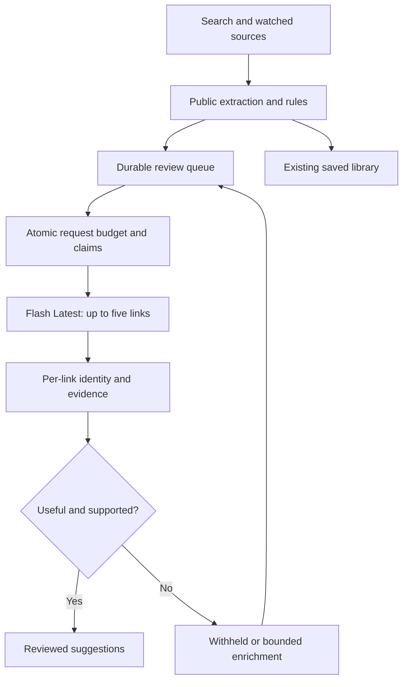

# AI-reviewed discovery

StackSignal uses Tavily, public GitHub discovery and source watches to find links. Gemini **evaluates public material already captured by the collector**; it is not the search engine or an independent fact checker.

## What members see

Every suggested-feed mode, including releases and All reviewed, admits only completed, useful assessments with medium/high confidence, practical/advanced depth, an exact source quote and an AI score meeting the administrator's minimum score. Pending links, low-confidence judgments, introductory/tangential results, insufficient evidence and errors stay out of suggestions. Saved library links remain accessible, including references members saved before this policy. Library titles and notes are not submitted to Google.

This week retains the publisher's seven-day date window. New to radar uses the assessment date, so a backlogged or undated reference can surface when its review completes without inventing a publication date. All reviewed has no age cutoff. Followed-release alerts and unread counts require review too, and respect prerelease settings.

Apply mode uses the existing 70% AI / 30% rules blend for high-confidence assessments; medium-confidence assessments preserve stored rules scores. Admission uses the AI decision and score independently, so useful unfamiliar tools can enter despite weak keyword overlap. Cards show the AI assessment score and label it AI reviewed. Evaluate without changing ranking still gates suggestions; Off pauses new evaluations but retains previously admitted links.

## Request and coverage budgets

| Control | Enforcement |
| --- | --- |
| Model | `gemini-flash-latest`; last resolved model recorded in Health |
| Batch size | Up to five links in one synchronous `generateContent` request |
| Daily requests | At most 16 in a rolling 24 hours **and** the Pacific calendar day |
| Monthly requests | At most 496 per UTC calendar month; administrator may lower it |
| Spacing | At least five minutes globally, one request per collector tick |
| Public source input | At most 6,000 UTF-8 bytes of text and 500 bytes of title per link |
| Output | 900 generation tokens per link, at most 4,500 per request; LOW thinking |
| Timeout | 30 seconds; no immediate provider retries |
| Input retries | At most three reservations for an unchanged article/context/input; six-hour lease |
| Provider errors | HTTP 5xx: 15-minute global cooldown; quota/auth/other HTTP errors: 24 hours; failures consume slots |
| Malformed batch | One-hour global cooldown; affected inputs wait at least six hours |

The owner's October 11, 2026 AI Studio screenshots show **5 RPM, 250,000 input TPM and 20 RPD** for Gemini 3.8 Flash on a Free-tier project. Sixteen daily requests leave four requests of daily headroom. These quotas are shared by every client in the Google project and can change when the latest alias changes. Keep the project dedicated to StackSignal and on the Free tier. Application ceilings cannot prove or control the project's billing tier. There is no paid fallback or alternate-model retry.

**Sixteen requests × five links gives an upper bound of 80 link assessments/day, not a throughput guarantee.** Small/failed batches, insufficient excerpts, unavailable sources and arrivals above capacity can cause delays. A monthly request ceiling is an application safeguard, not a Google monthly free allowance. Do not claim exhaustive discovery or instant review regardless of volume.

## Durable queue and extraction

The sweep loads the oldest 50 eligible pending public inputs, rotates preference among strong/borderline/exploration lanes and submits up to five atomically reserved inputs. Already leased inputs are skipped within the window, so an interrupted request does not unnecessarily block all other work. There is no seven-day queue expiry.

Existing references without public text enter a separate bounded extraction queue: up to eight records per tick, once per record, only for existing approved public hosts. PDFs and unsupported hosts remain visible in administrator coverage as missing public input. Public GitHub repository extraction uses API metadata and a bounded public README when available. Imported chat text, private notes and arbitrary user titles are never evaluation inputs.

A valid insufficient-evidence search snippet may request one richer approved-host fetch. Changed captured public text clears the old assessment and its error counters, returning the link to evaluation. Metadata-only changes preserve the assessment and reapply its ranking without another Gemini call. Failed unchanged inputs receive bounded delayed retries; after three reservations they remain withheld for inspection. No model-selected URL expands the fetch allowlist.

## Validation and concurrency

Each batch response binds an assessment to a supplied article id. Unknown or duplicate ids reject the whole response. Missing results and per-item validation failures are withheld while independently valid items can be saved. Each evidence quote must occur in **that item's** excerpt, preventing evidence from another batch member from being accepted. A complete STOP response, exact field set, types, enum values, score bounds and length limits are required.

Service-only `ss_reserve_evaluation_batch` uses the same transaction advisory lock for global spacing, rolling/Pacific/month ceilings and input claims. The request ledger counts calls; the claim ledger counts individual input reservations. Both private tables have RLS enabled and no client grants or policies. Historical single-link reservations carry into request accounting; the retired single-link reservation RPC always refuses new calls.

Before saving, the collector rereads the article and checks deletion, content hash and captured source fields. The update is also conditioned on the hash. Another source update cannot receive an assessment of stale text. Deployments, visitors and refreshes neither reset the ledger nor generate evaluations.

## Privacy

Only a fixed engineering mission, recognized public stack/interest vocabulary, numeric topic priorities and collector-fetched public excerpts reach Google. Free-form interests, custom search queries, names, comments, chats and internal topology are excluded. Source instructions are untrusted data. Gemini receives no tools, browsing or workspace access. Free-tier provider data-use terms still apply to the public inputs.

The API key remains a Supabase Edge Function secret, absent from browser assets, GitHub and logs. Structured output and a real quote substantiate relevance against an excerpt; they do not establish benchmark correctness or a complete-page review.

## Administration and activation

The existing workspace uses Apply, 16 requests/day and 496/month. All settings persist in PostgreSQL across redeployments. Independent installations remain Off with zero daily budget until an administrator configures a verified Free-tier API project and `GEMINI_API_KEY` in function secrets.

Health shows request usage, the current Pacific-day count, pending/reviewed/failed coverage, missing public extraction, last batch size, token usage, actual model version, error/cooldown and recent assessments. Counts are dated snapshots. A pause or quota limit can leave the feed temporarily empty; the UI explains pending review instead of claiming discovery is complete.

References: [Google rate limits](https://ai.google.dev/gemini-api/docs/rate-limits), [structured output](https://ai.google.dev/gemini-api/docs/structured-output), [billing](https://ai.google.dev/gemini-api/docs/billing), [architecture](ARCHITECTURE.md), [operations](OPERATIONS.md).
