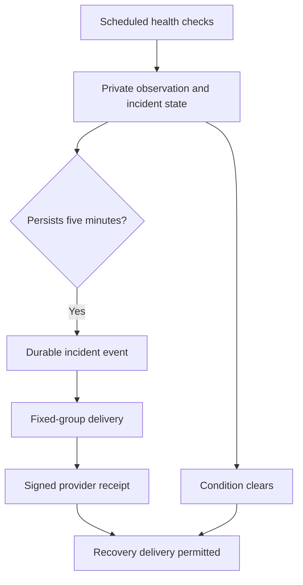

# Platform health and Columbus operations

Administrators open **Admin → Dashboard**, or `/?view=admin`. The dashboard
refreshes every 30 seconds while visible and labels observations older than
three minutes as stale. Its RPC checks active membership, the administrator
role and the existing MFA/session rules. Readers and maintainers cannot query
member statistics or private operational state.

## What is measured

The dashboard reports retained discoveries, distinct reviewed links per UTC day,
active watches, recorded reads/bookmarks, declared WhatsApp registration,
audited mutations and database size. These are stored measurements, not page
views, session duration, inferred engagement or confirmation of WhatsApp group
membership. Permanently discarded links are absent from retained counts.
Private notes and WhatsApp question bodies are never collected for BI.

The existing minute dispatcher now also checks database access, collection,
source watches, evaluation, local review, daily discovery, website status,
confirmed new-link delivery, paired WhatsApp connectivity, Ollama availability
and question processing. Signed, purpose-separated requests expose bounded
aggregate bot telemetry; public `/healthz` remains a liveness endpoint.

| Condition | Threshold / behavior |
| --- | --- |
| Source watch overdue | More than 30 minutes past its due/retry time |
| Collection job stuck | Running more than 10 minutes, or due pending more than 30 minutes |
| Review overdue | Eligible new link still unevaluated after 25 hours |
| Review heartbeat stale | No fallback/coverage observation in 20 minutes |
| Daily discovery stale | Enabled discovery lane has no success within 30 hours |
| Content delivery delayed | Pending more than 15 minutes, missing eligible event, or uncertain send |
| Paired listener stale | Connected heartbeat absent or older than two minutes |
| Question failure | Three generation failures/hour, an uncertain send, or a question stuck over four minutes |
| Independent VM watchdog | Context API unavailable, or external monitor stale for 20 minutes |

Expected quota, pacing, batching and reservation waits are displayed as waits.
They do not bypass the existing Gemini limits or imply a stuck evaluation.
Missing public evidence remains withheld. Ollama HTTP health does not certify
answer quality; deployment separately checks actual technical generations and
identity/language routing. Synthetic samples are reviewed inside the encrypted
maintenance report; automated checks alone cannot certify every answer.

## Incident delivery and recovery

One open incident exists per fixed condition code. Persistent incidents generate
one durable opening message, followed by one recovery message after confirmed
opening delivery. Retries keep the same event ID. An uncertain send freezes
that event for operator reconciliation; it is never blindly replayed. Conditions
that clear before the five-minute confirmation window send no message. The
independent VM watchdog follows the same durable opening/recovery ordering and
works without the LLM. The dashboard keeps the latest 50 incidents and bounded
recovery summaries; resolved operational history expires after 30 days unless
an event still requires attention.

A disconnected WhatsApp gateway cannot notify through WhatsApp while it is
down. The database monitor preserves the incident and dashboard evidence until
connectivity returns. A complete simultaneous database and VM outage likewise
needs provider monitoring or manual intervention; these checks are not an
external uptime guarantee.

## Columbus release questions

English `Columbus` and Hebrew `קולומבוס` / `קולמבוס` prefixes retain the fixed-group boundary.
Messages sent by the paired phone can arrive with the account as sender and
StackSignal as the recipient. The pre-decryption boundary verifies both the
socket's own identity and the fixed group recipient for this route. A scoped
async context permits the vendor's early sender filter only for that verified
frame; it does not allow personal messages, other group recipients or unrelated
self-sync traffic. Ordinary inbound group frames retain the same fixed target.
Ignored message packets receive the pinned library's metadata-only transport
NACK (`500`), preserving its normal ignored-message protocol without decrypting
them. This is neither a chat reply nor a read receipt. Only routing attributes
are passed to the acknowledgement method; private ciphertext never reaches a
receive handler or logger. Signed counters expose blocked frames and failed
acknowledgements without retaining identities or bodies.

Requests for recent/latest releases use an authenticated, read-only catalog
endpoint. It selects current approved releases per project using the same
release/channel/repository admission rules as the platform, ordered by discovery
time. A request for seven returns up to seven real titles, discovery timestamps
and platform links. It does not send seven new-link notifications or invent
versions through the LLM. Historical approved records may appear in an explicit
answer; automatic broadcasts still require first evaluation of a newly discovered
link after the original notification activation cutoff.

Busy/rate-limited requests receive a bounded retry notice. Generation or catalog
failures receive a safe explanation instead of disappearing. Durable question
metadata stores hashed senders, status, timestamps and fixed error codes, never
question or model thinking text. Old installations lack those error codes, so a
historical failed status alone cannot identify the exact underlying exception.

Exact English/Hebrew identity and capabilities questions use a bounded, maintained description
of real capabilities rather than depending on model availability. The current
local 4B model uses English-first answers after failing isolated Hebrew checks.
Both Hebrew prefixes include a maintained Hebrew English-language recommendation;
English prefixes answer directly in English. See [language policy](WHATSAPP_SETUP.md#columbus-questions-and-privacy). Leading mobile
RTL direction marks are ignored when matching the name; other name/prefix and
fixed-group checks still apply.

The owner-only manual `columbus_diagnostics` maintenance operation reads bounded
status and counters without restarting services. Its encrypted result includes
only fixed receive/rejection codes, counts and last-seen timestamps, alongside
question status/error codes and service health. It never returns message bodies,
addresses or credentials. Receive counters distinguish permitted group wire
frames from decoded upserts and local send echoes. A local-send canary proves
generation and delivery, **not** receipt of a real message from a phone; verify
that path with an actual group question and matching wire/upsert counters.
A sealed `quality_audit` verification mode is permitted only for this read-only
operation. It runs four fixed synthetic prompts against the installed local
model with no article context. Its answers are encrypted with the report, never
posted to the group; it collects no real questions and does not restart services.

Baileys normally uses a silent logger here, so an absence of journal errors
cannot establish that an incoming message was decrypted successfully.

## Automatic repair boundaries

`ss_ops_reconcile` requeues only unevaluated links whose recorded HTTP 400
provider-configuration error predates a subsequent successful provider request.
It records the recovery once, preserves request accounting, and never resets a
review or broadcasts an already evaluated backlog. A failed source job is
archived only when the same source subsequently completed successfully.
Uncertain delivery is intentionally excluded from automatic repair.

## Rollout and verification

1. Apply the additive migration and deploy the HMAC-protected `platform-context`
   Edge Function (`verify_jwt = false` because it verifies its own HMAC).
2. Update the existing paired VM through guarded maintenance; preserve its
   credentials, group boundary, delivery ledger and activation policy. Real
   local-model and signed catalog canaries must pass before readiness.
3. Deploy the updated `whatsapp-dispatcher` with its shared operations module.
   Verify fresh observations and signed bot telemetry before frontend release.
4. Merge verified source through `dev` to `main` and let the existing Quality,
   Production and Release jobs publish the dashboard.

Do not re-enable resource allocation, reset provider quotas, re-pair WhatsApp,
change the group or replay sent/uncertain events to investigate an incident.
Check `operations.ok` in dispatcher responses as well as content delivery counts;
HTTP 200 alone is not proof of a health observation or WhatsApp delivery.

## Historical investigation

**Admin → Dashboard → Historical diagnostics** filters transition records by UTC
calendar day, pipeline stage, or a job/article/source/event UUID. Cursor pagination
can retrieve older matching rows; results are limited to 100 per page. Scheduled
runs show a separate trace ID, start/end time, result, duration and processed-job
count. The collector returns `X-StackSignal-Trace-Id` and writes the same redacted
ID/result/timing to its provider log. A run that never finishes becomes abandoned
after ten minutes. Do not treat pg_cron's HTTP enqueue success as job completion.

| Data | Retention and limits |
| --- | --- |
| Health measurements | Latest observation per five-minute bucket; 30 days |
| Queue graph | Hourly peaks of retained samples; missing samples stay absent/null |
| Job, watch, review, request and delivery transitions | 14 days, capped at 100,000 rows |
| Scheduled run records | 30 days, capped at 20,000 rows |
| Incident evidence | Opening, latest failing and recovery measurements; existing 30-day resolved-incident retention |

Retention runs hourly inside the existing minute monitor; no extra scheduler,
paid monitoring service or resource allocation is introduced. Tables are private,
RLS enabled and inaccessible directly even to application service clients. Only
bounded service RPCs and administrator/MFA-gated diagnostic RPCs expose data.
Traces retain IDs, stage/phase, attempt, duration and a fixed error code. They do
not retain source text, URLs, titles, personal notes, raw provider errors,
credentials, phone numbers or WhatsApp messages. Trace identifiers can outlive a
deleted source/article until retention expires; they cannot recover its content.
A completed job can be linked to its retained article by `article_id`; watch jobs
and their source events share `source_id`. Evaluation request IDs locate provider
attempt spans; article review and notification spans share `article_id`.

Use the incident ID and observation timestamp first, then inspect queue peaks and
matching transition IDs. Compare a failure with its later successful attempt and
confirmed notification receipt. For stale collectors, inspect scheduled runs and
provider logs using the run trace ID. If historical detail predates diagnostics,
report the evidence gap explicitly. Never replay an uncertain WhatsApp send or
reset evaluation quotas as an investigation shortcut.

See [the October 20–21 incident review](INCIDENT_REVIEW_2026-10-21.md) for the
initial investigation, evidence limits and release verification.
