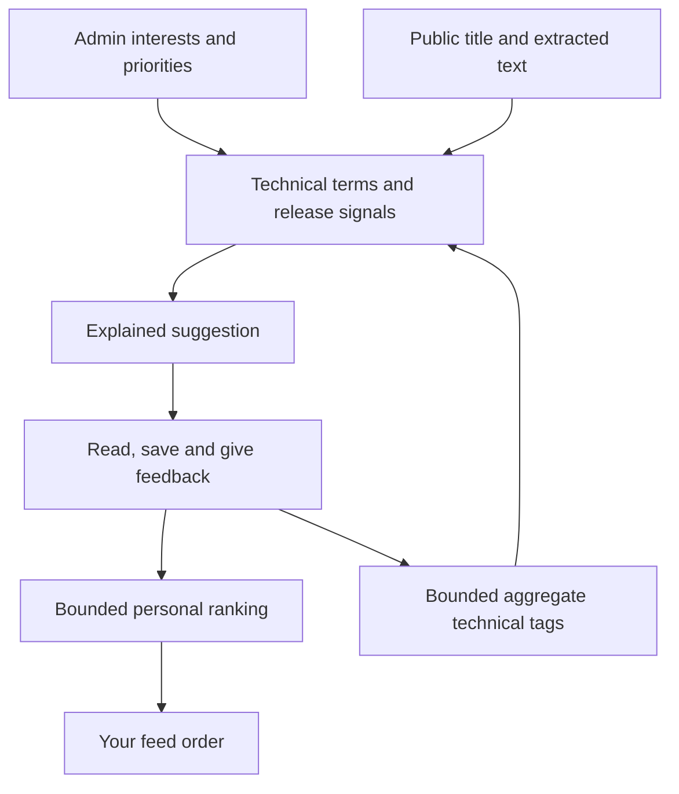

# Product guide

[Documentation hub](README.md) · [Onboarding and roles](ONBOARDING.md) · [Coverage](COVERAGE.md)

StackSignal has two connected jobs: discover useful public engineering material and preserve the team's understanding of it. Suggestions help you catch up; the shared library keeps knowledge reachable after it leaves the feed.

## A daily reading routine

1. **Start with This week.** Filter by topic, content type or unread status. Switch between relevance and recency depending on whether you want the strongest matches or the latest publications.
2. **Review Releases.** Discovery shows one latest approved release per project. Open the original release notes for projects you follow. Check versions, breaking changes and prerequisites before applying anything to production. Older versions saved by a member remain in the shared library.
3. **Explore New to radar.** This is where older but newly encountered tools and projects can enter your view.
4. **Check Updated docs.** Read changes to watched documentation; a detected change is not a publisher's new release announcement.
5. **Capture the useful part.** Administrators/maintainers can save links, leave notes and give helpful/not-relevant feedback. Readers can consume the shared result.

## The five feed views

| View | Time basis and contents | Use it for |
| --- | --- | --- |
| **This week** | Items with an actual publication date in the last seven days; ordinary items meet the configured relevance threshold, followed releases are included | Recent publications relevant to the stack |
| **Releases** | Followed release items published in the last seven days, subject to stable/prerelease settings | Upgrade awareness and unread release alerts |
| **New to radar** | Non-release items first discovered in the last seven days through source watches/public discovery, subject to relevance filtering | Projects or material you had not encountered, even if published earlier |
| **Updated docs** | Items with a recorded update/detected-change time in the last seven days, subject to relevance filtering | Changes to existing material; inspect the item type and date basis |
| **All reviewed** | Approved discovery without the weekly time window; review, score, maintenance and channel gates still apply, with one current release per project | Reviewed references beyond this week |

Unread state and hidden/not-relevant state are personal. Saved links and folder structure are shared. An alert means there are unread followed releases in the weekly window; it is an in-app entry into the Releases view.

## Read the card and details together

Cards summarize title, source, content type, tags and topic fit. Details retain the original link and show metadata, relevance reasons and evidence when available.

| Field or label | Interpretation |
| --- | --- |
| **Published** | Publication/release date when available; web-search dates may be provider-reported, as labeled in details; unknown dates remain unknown |
| **Discovered** | When StackSignal first encountered the item |
| **Updated** | A publisher update or detected change, depending on provenance |
| **Topic match / relevance** | Fit to the technical profile; not correctness, quality certification or compatibility |
| **Why this matters** | Explanation of technical matches and available supporting text |
| **Link checked** | The destination was fetched; its technical claims were not independently validated |
| **Web search result** | Tavily returned the link/excerpt; this alone does not establish a destination fetch or validate its claims |
| **Metadata pending / Needs review** | An incomplete, submitted or unresolved reference that needs extraction or human review |

A chat timestamp is never turned into a publication date. Repository activity/stars are discovery signals, not an endorsement. An issue or merged PR is not proof that its fix has reached a stable release.

## Save and organize knowledge

Administrators and maintainers can create shared folders/subfolders, rename or move them, and save an item to more than one folder. Saving without a selected folder uses the shared Inbox.

Keep folder names tied to how people retrieve knowledge. Useful roots might be `Inference`, `Networking`, `Platform`, `Hardware` and `Benchmarks`; a more focused subtree might be `Inference / KV cache / Offloading`. These are examples, not a required taxonomy.

Library search matches **saved titles**, using keyword/full-text and substring matching. At the root it searches all saved items across folders/subfolders; inside a folder it searches that subtree. It is not a semantic search over full article text, comments or private notes.

Unsave, delete and not-relevant actions require confirmation. Deleted folders and notes go to Trash for a 30-day recovery window; they are not a permanent archive. Removing a bookmark does not delete the canonical article. Pause/removal of a source stops future monitoring while preserving the stored knowledge.

## Notes and discussion

| Visibility | Audience | Intended use |
| --- | --- | --- |
| **Team** | Active members with access | Applicability, experiments, caveats and shared conclusions |
| **Private** | The author through the app | Personal reading notes and unfinished thoughts |

Replies are team-visible and attach to team notes. Authors edit their own notes. An administrator can moderate another author's team note, but cannot read another member's private note through the app. A note's visibility cannot be silently switched during editing; create a new note with the intended visibility.

Private notes are database access-controlled, not end-to-end encrypted. Supabase project/database operators have privileged access outside the application role model. Never use notes as a secret manager.

A useful shared note records the claim, its source/version, your environment's applicability and the next measurement. Distinguish a published benchmark from your own observation; avoid turning estimates into facts.

## Give feedback and submit missed links

**Helpful** records positive feedback. **Not relevant** hides the item for you after confirmation and contributes negative feedback. Hidden items can be restored through Hidden signals. Feedback adjustments are bounded so a few clicks do not dominate the whole ranking system.

Personal topic/tag feedback affects your ordering. Aggregated technical-tag feedback also informs future ingestion. Private note bodies, usernames and feedback reasons are not sent to discovery providers. This is local ranking feedback, not training an external model.

When you submit a missed public link, StackSignal preserves the reference, saves it and queues supported analysis. You can provide a useful title/reason and choose whether it should teach helpful feedback. Metadata may remain pending when the host is not approved or the content is unsupported.

**Submitting a link does not subscribe the hub to its whole website or repository.** Ask an administrator to add a watch or improve discovery queries when ongoing monitoring is appropriate.

## Follow projects and monitor source health

Administrators can add/edit GitHub watches, feeds, official OpenShift release streams and documentation sources, including topic, priority, interval, active state and release channel. GitHub repository URLs normalize to release API endpoints; duplicate project watches are rejected.

- Stable releases are the default. Drafts are excluded; prereleases require opt-in.
- Existing results retain canonical release URLs/tag metadata; repeated polling does not create a new unread item for the same article.
- Supported issue/PR watches track their own state and dates. They are not substitutes for a release watch.
- Reconfigured/paused/deleted sources invalidate stale queued work through source revisions.
- Scan-now marks a source due. The scheduled collector still applies queue fairness, request budgets and retry/deferral rules.

Source health shows last success, last error, next check and item counts when available. “Awaiting scan” means there is no successful fetch yet. A source definition alone does not prove the endpoint is healthy or that the project publishes releases.

## How relevance improves

Specific stack terms carry more weight than generic vendor mentions. The deterministic ranker recognizes performance, security, compatibility and implementation signals, and discounts some promotional/finance headlines. Followed releases receive a strong relevance floor because the administrator explicitly selected the dependency.

Optional [Gemini evaluation](GEMINI_EVALUATION.md) evaluates strong, borderline and exploratory public discoveries in batches. Administrators can compare assessments without changing scores, then opt into confident semantic ranking. The existing deployment is active in Apply mode on a confirmed Free-tier Google project, using `gemini-flash-latest`; Health records the actual resolved version. Separate installations require free-tier API-key activation. [Tavily web discovery](WEB_DISCOVERY.md) is active in the existing deployment, rotating recent coverage with broader exploration and filtering obvious portfolio/hiring/finance noise. Source watches, feeds, public repository discovery and local relevance work without requiring a paid LLM.

The card displays the stored technical score, while relevance sorting also uses a bounded personal adjustment. Interests and feedback do not automatically rewrite search queries. For exact arithmetic, a worked example and current limits, read [Discovery and scoring](DISCOVERY.md).

## What the product does not claim

- Exhaustive internet coverage or real-time notification of every upload.
- Independent benchmark reproduction, hardware compatibility validation or automatic production tuning.
- Email/mobile push delivery, arbitrary-site crawling or full PDF/video transcription.
- Full-text/semantic search across notes and article bodies.
- Unlimited free provider capacity or unlimited API usage from consumer AI subscriptions.
- A complete database/Auth backup through the application export.

For collection rules and provenance, read [coverage](COVERAGE.md). For trust boundaries, recovery and known verification limits, read [security](SECURITY.md) and [operator onboarding](ONBOARDING.md#operators).

Repository suggestion thresholds and daily/weekly Trending are editable under Administration → Coverage. Details show real watcher counts, release activity, license and snapshot age. See [maintenance and platform probes](REPOSITORY_DISCOVERY.md).
