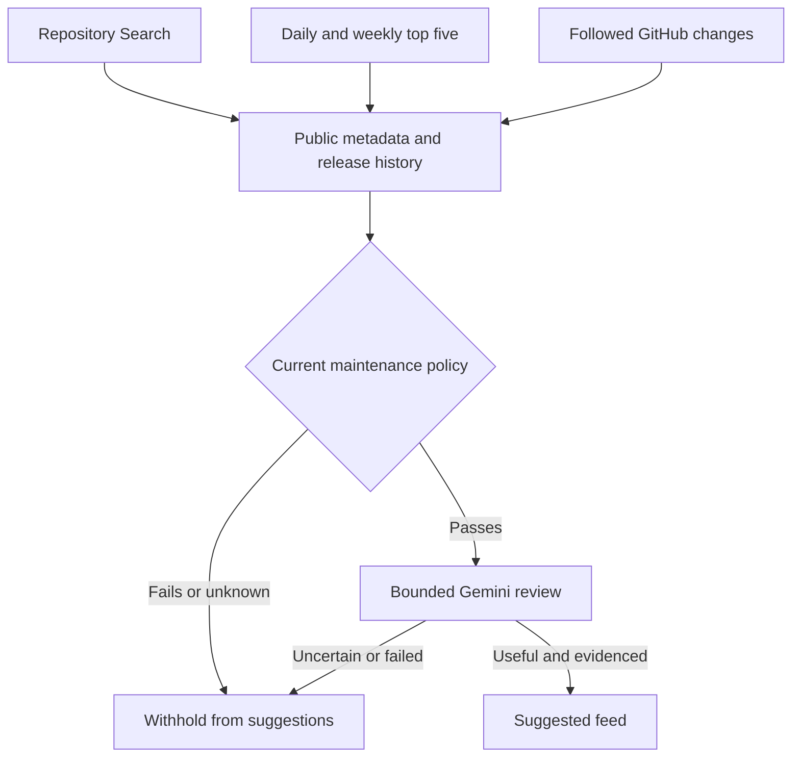

# Repository quality, Trending and OpenShift probes

[Documentation hub](README.md) · [Discovery](DISCOVERY.md) · [AI evaluation](GEMINI_EVALUATION.md)

StackSignal screens GitHub projects using observable maintenance signals **before spending Gemini requests**. This is an admission policy, not an independent security audit or proof of peer-reviewed code.

| Signal | Initial default | Administrator control |
| --- | --- | --- |
| Stars | At least 100 | 1–100,000 |
| Actual watchers | At least 5 | 1–10,000 |
| Published releases | At least 2 in the past 365 days, including prereleases, excluding drafts | 1–20 |
| Last push | Within 90 days | 7–365 days |
| Latest published release | Within 180 days | 30–730 days |
| State | Public, active, non-fork, not archived or disabled | Always required |
| License | Declared SPDX identifier, excluding NONE/NOASSERTION/unknown | Always required |
| Health snapshot | Refreshed after 24 hours; expires after seven days | Fixed safety boundary |

GitHub's `watchers_count` is a historical stars alias. StackSignal uses `subscribers_count` from the full repository API for actual watchers. A declared license is a discovery signal; the app does not perform legal license classification. Release counts are bounded to fetched recent release entries (up to 20 for independent health lookups); it never invents missing release history. A push date alone can include bot activity, so both push and release activity are required. Popularity can be manipulated and is never a certification.

The policy applies to **every GitHub suggested link**, including followed releases, PRs, commits and Trending discoveries. Unknown or stale health fails closed. Administrator threshold changes apply at feed-read and request-reservation time; no repeat AI generation is needed. Saved library references are still accessible. Explicitly following or submitting a niche repository does not bypass the policy. Recent useful reviews receive priority for public health refresh; other repositories join a bounded queue. GitHub rate limits can delay snapshots.

## Discovery lanes

Repository Search uses the saved technical queries, at most six results per query, alternating updated/stars sorting on UTC days. It prefilters low-star candidates, obtains actual repository/release metadata and captures public README text for admitted candidates.

A separate **GitHub Trending probe** reads the public daily and weekly pages once per UTC day. It takes the first five repositories in GitHub's own order, then applies the same maintenance policy and AI relevance gate. Ranking is recorded with period and observation time. Queue deduplication includes the discovery lane and period, so daily and weekly probes run independently. A project being in the top five does not automatically make it groundbreaking or useful. If markup changes or the publisher blocks the request, the probe reports an error; it does not fabricate a fallback ranking. Administrators can pause Trending independently, or pause all project discovery.

Health metadata is cached in server-only settings. The collector reuses metadata across release/PR jobs; an hourly GitHub ceiling and publisher backoff still apply. The AI candidate query filters quality before its oldest-50 limit, preventing weak repositories from blocking stronger candidates. The database also checks quality during atomic request reservation and feed retrieval.

## OpenShift release streams

The `openshift` source type polls the official release-controller JSON API:

- `https://amd64.ocp.releases.ci.openshift.org/api/v1/releasestream/4-stable/tags`
- `https://amd64.ocp.releases.ci.openshift.org/api/v1/releasestream/5-stable/tags`
- Equivalent `4-dev-preview` and `5-dev-preview` streams.

These are amd64 CI release streams, not a Red Hat support or upgrade recommendation API. On October 11, 2026, the official dashboard listed **5.0.0-rc.6**, newer than the supplied rc.3 reference. Other architectures and streams are not covered by this initial probe.

The probe selects up to five Accepted tags per source check and fetches their individual API details and decoded changelogs. Official per-tag detail responses allow at most 8 MB (encoded changelog at most 6 MB); ordinary source bodies remain capped at 2 MB. Only supported version/tag formats are accepted. RC and engineering preview entries require the source's prerelease opt-in and remain visibly labeled. `Accepted` denotes CI state, not GA, support or safe upgrades. The four initial stream watches opt in to previews; administrators can edit, pause, delete or change them at any time.

A publisher creation date is extracted from the changelog when available. Missing dates remain null. Canonical release URLs deduplicate repeats; change detection does not fabricate a release date. These entries require the same useful AI review as other releases but no GitHub popularity gate because the publisher is the official OpenShift release controller.

## Expanded team references

The additive second batch contains 38 sanitized public references and 30 source definitions. Existing URLs, folders, comments, account settings and bookmarks are preserved. The October 11 live import created 28 new references, 29 additional bookmarks and 27 watches; older duplicates were reused. A private sandbox link is retained separately as an unfetched library reference and is never committed in the public seed.

Coverage now explicitly includes kagent/Agent Substrate, Agentgateway, OpenFGA/Anthropic gateway integration, MSCCLPP, MoonEP, DeepGEMM, CacheBlend, ChunkKV and LMCache S3. User-shared PRs and issues are tracked individually. PR state is not interpreted as a released feature; commit references do not imply deployment or release inclusion. The ConnectX-8 short URL remains unresolved rather than inventing its destination. PDFs are saved references; automatic PDF text extraction is not enabled.

The original seed is immutable. The expansion uses its own idempotent import key and is generated by [knowledge-expansion.ts](../lib/knowledge-expansion.ts). Reapplying an identical payload is a no-op; changing it requires a new batch key. See [import script](../scripts/import-knowledge-expansion.mjs).
