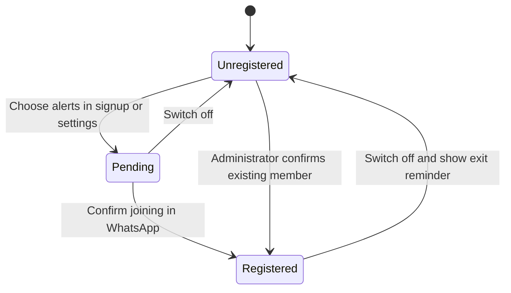

# WhatsApp registration

Registration records the member's choice in StackSignal. WhatsApp owns group
membership. The application cannot automatically add or remove someone by
changing a database field, and it does not expose or inspect personal chats.

Signup is optional and unchecked by default, with a reminder that registration
is always available later. An opted-in new member sees the join dialog after
signing in (and satisfying required MFA). Settings show Unregistered, Waiting
to join or Registered. The join button opens the protected canonical WhatsApp
invite; the member completes joining in WhatsApp and chooses “I’ve joined the
group.” Registration is then recorded as `user_confirmed`, with a timestamp.
Existing members explicitly confirmed by the owner use `admin_confirmed`.
Neither label claims automated membership verification.

Switching off clears the confirmation and records Unregistered immediately.
The resulting dialog explains how to exit the StackSignal group in WhatsApp;
messages continue for actual group members until they leave. Registering again
starts at Pending. Repeating an existing choice or confirmation preserves its
timestamp. A new login reoffers the invitation while registration is Pending.

## Data and authorization

`ss_members` retains `whatsapp_opt_in` for old clients and adds
`whatsapp_registration`, `whatsapp_registered_at`,
`whatsapp_registration_source` and `whatsapp_updated_at`. A database check keeps
them consistent. State changes are recorded in the existing protected audit
log. No phone number is collected by the UI.

`ss_whatsapp_preferences(boolean)` reads or changes only `auth.uid()` after the
existing live-session/member/MFA check. `ss_whatsapp_confirm_joined()` has no
member-ID argument and requires opt-in. Both use a row lock for serialized
transitions, an empty search path and explicit execution grants. Anonymous and
service-role callers cannot use the member confirmation endpoint. Direct
member-table updates remain denied. The signup wrapper performs invitation
completion and Pending registration in one transaction.

Invite URLs are returned only to opted-in authenticated members, validated on
the server/database and again in the UI, and opened with `noopener noreferrer`.
Administrators see registration labels in their existing member table.

## Verification and recovery

The additive migration is `20261018074722_whatsapp_registration_status.sql`.
Apply it before releasing the new API/UI. Old preference callers remain valid;
rollback the UI rather than dropping registration history. Do not rerun named
member onboarding as a general migration. The owner-confirmed three-member
update was a guarded operational transaction, not seeded personal data in Git.

Database regressions run the entire migration chain, exercise live-session/MFA
gates, own-user isolation, unauthorized direct writes, state consistency,
confirmation idempotency, invite transactions and notification outbox receipts.
Browser regressions cover phone/desktop joining, confirmation, persistence,
leaving, failed saves and signup-to-login handoff in three browser engines.

See [setup](WHATSAPP_SETUP.md), [current checkpoint](WHATSAPP_PROGRESS.md) and
[branch/release rules](BRANCHING.md) for deployment and approval boundaries.
