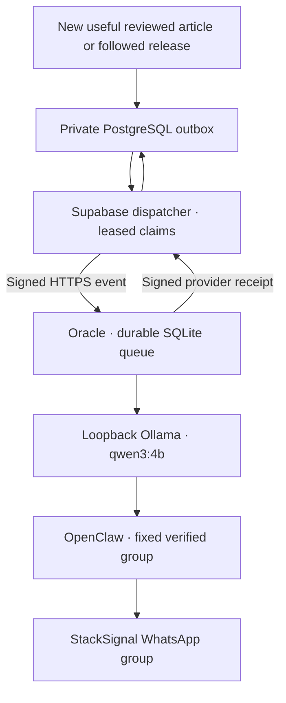

# WhatsApp operations

The existing Oracle ARM host is installed, paired and restricted to the verified
StackSignal group. Do not allocate another VM, rerun bootstrap or relink the
working account. [The checkpoint](WHATSAPP_PROGRESS.md) records current delivery
verification and activation status. [Registration](WHATSAPP_REGISTRATION.md)
explains signup, settings and the distinction from actual group membership.

## Runtime and trust boundaries

| Component | Installed baseline |
| --- | --- |
| Oracle host | Jerusalem A1 ARM, 2 OCPU / 12 GB RAM, one 50 GB boot volume |
| Node | 24.19.0 |
| OpenClaw / WhatsApp plugin | 2026.10.3; pinned Baileys 7.0.0-rc14 |
| Ollama | 0.40.4; local qwen3:4b; cloud features disabled |
| Caddy | 2.11.7; public HTTPS health and signed event endpoint only |
| Services | `ollama`, `stacksignal-openclaw`, `stacksignal-bot`, `caddy` |

The model receives bounded reviewed public metadata, never private notes,
credentials or incoming chats. It has no tools. The message formatter fixes the
original discovery/evaluation timestamps and authenticated StackSignal link;
the model cannot invent destination URLs. Notification generation uses no
Gemini quota. A shared group means every actual member receives the same stream.

OpenClaw, Ollama and receiver administration are loopback-only. Inbound DMs,
group conversations and agent tools are disabled. Only the fixed group is a
notification target. The bot holds no database service key. One queue worker
and one linked session run on the host; never duplicate these onto a concurrent
replacement host.

## Private configuration

| Location | Contract |
| --- | --- |
| `/etc/stacksignal/bot.env` | Root-owned, group-readable 0640: shared webhook signing secret, exact platform origin, local model, fixed private group JID |
| `/var/lib/stacksignal-bot/openclaw/` | Service-owned private account state and paired credentials |
| `/var/lib/stacksignal-bot/deliveries.sqlite` | Durable delivery/deduplication ledger; retain associated WAL safely |
| `/var/lib/stacksignal-bot/activation/` | Private verified destination and one-time announcement receipt |
| Supabase Vault | Separate dispatcher invocation secret, webhook secret, endpoint and platform origin |
| `ss_private.whatsapp_configuration` | Global enabled flag, activation watermark, origin and canonical private group invite |

Never commit actual invite tokens, group IDs, phone numbers, private keys,
provider responses or database exports. Credentials belong in secret stores,
not command-line arguments or Actions log messages. Preserve encrypted backups
of paired state and SQLite/WAL outside Git. Changing the invite does not mean
changing the target group; independently verify identity before any change.

## Dispatcher and activation

Deploy `supabase/functions/whatsapp-dispatcher` with `verify_jwt=false`; its
separate `x-whatsapp-dispatch-secret` is mandatory. It uses its built-in Supabase
service identity. Configuration can come from protected Edge environment
variables or the service-only `ss_whatsapp_dispatch_configuration()` Vault RPC.
The VM receives only signed content events, never that service identity.

`bot/deploy/prepare-cron.sql` is an operator-only, paused-by-default setup step
for the one-minute `ss-whatsapp-dispatch` schedule. It is already prepared on
the existing installation; do not recreate it as routine maintenance. Preserve
the independent collector/evaluator/internal-review jobs.

Activation requires successful real article/release delivery, signed receipts,
replay/restart checks, passing CI and the owner's private-preview approval.
Then set `active_from=now()` and `enabled=true` together and activate only the
named WhatsApp dispatch cron. The new watermark prevents historical backfill.
Verify a newly evaluated qualifying event, the provider receipt and the group's
actual message. Main promotion follows [the branch convention](BRANCHING.md).

To pause, disable the named dispatch cron and set the global flag false.
Already accepted host work can finish; inspect the SQLite ledger before making
any destination change. Do not delete delivery history to retry a message.

## Delivery recovery

A webhook 202 is acceptance, not delivery. The same immutable event ID is polled
until the host returns a signed receipt with the provider message ID. Only then
does PostgreSQL mark Sent and clear the copied payload. Repeated events cannot
send again. Lost HTTP responses safely repeat that same ID.

Generation failures use bounded backoff. Restarted `generating` work returns to
the queue; interrupted `sending` work becomes `uncertain` and never blindly
retries. Inspect the actual group/provider and private ledger before manual
reconciliation. A disconnected WhatsApp gateway is a delivery failure even if
HTTP health is green. Check `openclaw channels status --json` under the existing
service account and inspect private diagnostics; do not publish credentials.

## Guarded manual maintenance

The owner-only `whatsapp_pairing` manual CI operation accepts an exact-commit,
15-minute private encrypted request. It verifies the saved existing host, no
active provisioning lease and disabled provisioning control. A temporary runner
/32 SSH rule is added and removed in `finally`; trusted SSH identity comes from
the retained verified host key. No maintenance operation can allocate a VM.

- `pair`: for explicit recovery of an unlinked account only. Uses the installed
  pinned library; the owner enters the encrypted phone-pairing code in WhatsApp.
  Existing registered credentials are never overwritten.
- `activation_test`: resolves the exact invite/name/membership and sends a
  one-time guarded announcement. A Sent ledger returns the existing receipt;
  uncertain sends are never automatically repeated.
- `delivery_readiness`: re-verifies the group, restarts the gateway, configures
  only an empty or identical fixed destination and checks all services. It
  refuses outstanding deliveries and any destination replacement. Repeating it
  after confirmed sends verifies restart persistence without another message.

Delete the short-lived Actions request after each operation. Keep QR/SSH
recovery available without asking the owner to repeat installation. WhatsApp
Web sessions can require future re-pairing; free hosting and provider capacity
are finite, so this is not a guaranteed-delivery SLA.

## Independent installation and tests

For another deployment, use [the dormant provisioning toolkit](../ops/oci/README.md)
and its explicit preflight/installation process. It preserves pinned download
verification, free-envelope guards, exact resource identity, secure boot/SSH,
model benchmarking, TLS and complete configuration. Historical investigation is
in the archive. No hourly capacity workflow is active.

Run app/collector type checks, `pnpm test`, the five Python safety suites in CI,
the standalone build, client-boundary check and three-engine browser regressions.
Use synthetic fixtures for automated tests; real group tests must be explicitly
labeled, bounded and preserve receipts. Never infer delivery from a green
scheduler run alone.

Provider references: [OpenClaw WhatsApp](https://docs.openclaw.ai/channels/whatsapp),
[message CLI](https://docs.openclaw.ai/cli/message),
[Ollama API](https://docs.ollama.com/api/generate),
[local-only settings](https://docs.ollama.com/faq),
[Caddy HTTPS](https://caddyserver.com/docs/automatic-https),
[Oracle Always Free](https://docs.oracle.com/en-us/iaas/Content/FreeTier/freetier_topic-Always_Free_Resources.htm).
