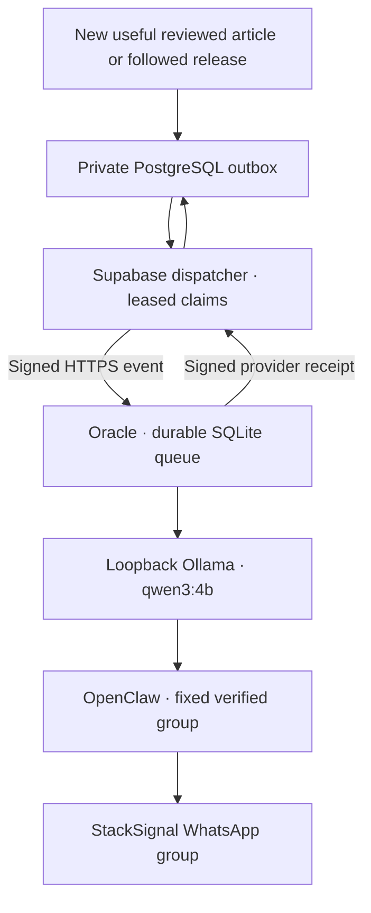

# WhatsApp operations

The existing Oracle ARM host is installed, paired and restricted to the verified
StackSignal group. Do not allocate another VM, rerun bootstrap or relink the
working account. [The checkpoint](WHATSAPP_PROGRESS.md) records current delivery
verification and activation status. [Registration](WHATSAPP_REGISTRATION.md)
explains signup, settings and the distinction from actual group membership.

## Final-answer replies

Columbus requests non-thinking generation with a strict JSON schema for the
direct `answer`, up to three `details`, and an optional `caveat`. The server adds
consistent headings and bullets. Each field is length-bounded and checked;
malformed, empty, token-truncated, reasoning-tagged or wrong-language output is
withheld. A single clean retry is permitted within a three-minute total deadline.
Raw generation text and Ollama's separate `thinking` field are never forwarded.
Clarity and accurate technical content take priority over the optional dry wit.
Validation does not guarantee that every model claim is correct.

For a reply-only update, the encrypted `columbus_deploy` request can set
`verification_mode: "answer_only"`. The existing-host installer exercises actual
English model answers about scheduling and networking, verifies identity/language
routing and the signed release catalog, then verifies reconnection after restart.
Synthetic model samples stay inside the encrypted owner report for human review;
no real conversation bodies are collected. This mode sends no group test messages
and does not relink, provision or alter notification activation. Full setup
verification retains its explicit group delivery tests.

## Runtime and trust boundaries

| Component | Installed baseline |
| --- | --- |
| Oracle host | Jerusalem A1 ARM, 2 OCPU / 12 GB RAM, one 50 GB boot volume |
| Node | 24.19.0 |
| OpenClaw / WhatsApp plugin | 2026.10.3; pinned Baileys 7.0.0-rc14 |
| Ollama | 0.40.4; local qwen3:4b; cloud features disabled |
| Caddy | 2.11.7; public HTTPS health and signed event endpoint only |
| Services | `ollama`, `stacksignal-openclaw`, `stacksignal-bot`, `caddy` |

The alert model receives bounded reviewed public metadata, never private notes
or credentials. It has no tools. The message formatter fixes the title,
original discovery/evaluation timestamps and authenticated StackSignal link;
the model cannot invent destination URLs. Notification generation uses no
Gemini quota. A shared group means every actual member receives the same stream.

OpenClaw, Ollama and receiver administration are loopback-only. Generic inbound
DM/group agents and tools stay disabled. The separate Columbus handler accepts
fresh text questions only from the verified group, with a socket boundary before
chat-body decryption. Only that group is a send target. The bot holds no database service key. One queue worker
and one linked session run on the host; never duplicate these onto a concurrent
replacement host.

## Private configuration

| Location | Contract |
| --- | --- |
| `/etc/stacksignal/bot.env` | Root-owned, group-readable 0640: shared webhook signing secret, exact platform origin, local model, fixed private group JID |
| `/var/lib/stacksignal-bot/openclaw/` | Service-owned private account state and paired credentials |
| `/var/lib/stacksignal-bot/deliveries.sqlite` | Durable delivery ledger and public article context; retain associated WAL safely |
| `/var/lib/stacksignal-bot/columbus.sqlite` | Question IDs, hashed sender, status and reply receipts; no question/answer bodies |
| `/var/lib/stacksignal-bot/activation/` | Private verified destination and one-time announcement receipt |
| Supabase Vault | Separate dispatcher invocation secret, webhook secret, endpoint and platform origin |
| `ss_private.whatsapp_configuration` | Global enabled flag, activation watermark, origin and canonical private group invite |

Never commit actual invite tokens, group IDs, phone numbers, private keys,
provider responses or database exports. Credentials belong in secret stores,
not command-line arguments or Actions log messages. Preserve encrypted backups
of paired state and SQLite/WAL outside Git. Changing the invite does not mean
changing the target group; independently verify identity before any change.

## Dispatcher and activation

Deploy `supabase/functions/whatsapp-dispatcher` with `verify_jwt=false`; its
separate `x-whatsapp-dispatch-secret` is mandatory. It uses its built-in Supabase
service identity. Configuration can come from protected Edge environment
variables or the service-only `ss_whatsapp_dispatch_configuration()` Vault RPC.
The VM receives only signed content events, never that service identity.

`bot/deploy/prepare-cron.sql` is an operator-only, paused-by-default setup step
for the one-minute `ss-whatsapp-dispatch` schedule. It is already prepared on
the existing installation; do not recreate it as routine maintenance. Preserve
the independent collector/evaluator/internal-review jobs.

Activation requires successful real article/release delivery, signed receipts,
replay/restart checks, passing CI and the owner's private-preview approval.
Then run the guarded operator transaction in
`bot/deploy/activate-notifications.sql` to set a fresh activation watermark and
activate only the named WhatsApp dispatch cron. Both discovery and first-review
timestamps must be at or after the new watermark. Historical pending links,
reevaluations and metadata refreshes never create alerts. Each alert includes
the source title so a member can search for it in StackSignal.
Verify a newly evaluated qualifying event, the provider receipt and the group's
actual message. Main promotion follows [the branch convention](BRANCHING.md).

To pause, run `bot/deploy/pause-notifications.sql`, which disables the named
dispatch cron and sets the global flag false.
Already accepted host work can finish; inspect the SQLite ledger before making
any destination change. Do not delete delivery history to retry a message.

## Delivery recovery

A webhook 202 is acceptance, not delivery. The same immutable event ID is polled
until the host returns a signed receipt with the provider message ID. Only then
does PostgreSQL mark Sent and clear the copied payload. Repeated events cannot
send again. Lost HTTP responses safely repeat that same ID.

Generation failures use bounded backoff. Restarted `generating` work returns to
the queue; interrupted `sending` work becomes `uncertain` and never blindly
retries. Inspect the actual group/provider and private ledger before manual
reconciliation. A disconnected WhatsApp gateway is a delivery failure even if
HTTP health is green. Check `openclaw channels status --json` under the existing
service account and inspect private diagnostics; do not publish credentials.

## Guarded manual maintenance

The owner-only `whatsapp_pairing` manual CI operation accepts an exact-commit,
15-minute private encrypted request. It verifies the saved existing host, no
active provisioning lease and disabled provisioning control. A temporary runner
/32 SSH rule is added and removed in `finally`; trusted SSH identity comes from
the retained verified host key. No maintenance operation can allocate a VM. Maintenance runs from `dev` after
feature integration; the current feature branch is also allowed during rollout.

- `pair`: for explicit recovery of an unlinked account only. Uses the installed
  pinned library; the owner enters the encrypted phone-pairing code in WhatsApp.
  Existing registered credentials are never overwritten.
- `activation_test`: resolves the exact invite/name/membership and sends a
  one-time guarded announcement. A Sent ledger returns the existing receipt;
  uncertain sends are never automatically repeated.
- `delivery_readiness`: re-verifies the group, restarts the gateway, configures
  only an empty or identical fixed destination and checks all services. It
  refuses outstanding deliveries and any destination replacement. Repeating it
  after confirmed sends verifies restart persistence without another message.
- `columbus_deploy`: preserves paired credentials, re-verifies the fixed group,
  installs reviewed runtime files and the hash-guarded socket adapter, checks
  real local-model answers, language policy and restart persistence. Failure restores the
  previous runtime and environment. Read the encrypted report: a green runner
  alone does not mean deployment succeeded.

## Columbus questions and privacy

Start a StackSignal-group message with `Columbus`, `קולומבוס` or `קולמבוס`,
followed by a question. English prefixes are case-insensitive. Exact identity and
capabilities questions use maintained answers; recent-release requests read the
signed platform catalog. General technical questions go to the local model.

The current `qwen3:4b` deployment uses **English-first replies**. Both Hebrew
prefixes add a short, maintained Hebrew notice recommending an English question
starting with `Columbus`, then provide the answer in English. An English prefix
requests an English answer directly, without that notice. This also applies to
identity, capabilities, catalog and failure replies. The owner reported broken
Hebrew; an isolated four-prompt audit reproduced confused Hebrew identity and
technical answers without article context, while English samples were coherent.
This is a policy for the installed model, not a claim about every Hebrew-capable
model. Reassess through a reviewed bilingual audit before enabling generated
Hebrew. No external inference provider or additional Gemini usage is introduced.

Quote a delivered alert to bind an explanation to that article. An explicit
reference such as “this article” or “the latest article” can select the last
retained alert. A general question receives no article context. Only public title,
summary, value, evidence and platform URL from the outbound ledger are used.
Context expires after 30 days. Arbitrary quoted chat bodies, personal chats,
contacts and URLs are not read or fetched.

The local model has no shell, tools, browsing or external-action permission.
Questions have a 3,000-character bound, a ten-minute freshness window, durable
ID deduplication, a ten-second per-sender interval and a 24-question hourly group
limit. One answer generates at a time; busy/limited requests receive a bounded
notice and are not replayed. Interrupted sends become uncertain and require
reconciliation.

The adapter is pinned to the exact OpenClaw WhatsApp 2026.10.3 session chunk.
Unknown vendor hashes fail closed. It filters routing metadata before Baileys
message handling, disables history/init-directory queries and restricts both
send/relay methods to the fixed group. The generic agent policies remain off.
Do not upgrade OpenClaw/plugin independently: review the new socket contract,
update the expected hash and rerun boundary and live question tests first.

Delete the short-lived Actions request after each operation. Keep QR/SSH
recovery available without asking the owner to repeat installation. WhatsApp
Web sessions can require future re-pairing; free hosting and provider capacity
are finite, so this is not a guaranteed-delivery SLA.

## Independent installation and tests

For another deployment, use [the dormant provisioning toolkit](../ops/oci/README.md)
and its explicit preflight/installation process. It preserves pinned download
verification, free-envelope guards, exact resource identity, secure boot/SSH,
model benchmarking, TLS and complete configuration. Historical investigation is
in the archive. No hourly capacity workflow is active.

Run app/collector type checks, `pnpm test`, the five Python safety suites in CI,
the standalone build, client-boundary check and three-engine browser regressions.
Use synthetic fixtures for automated tests; real group tests must be explicitly
labeled, bounded and preserve receipts. Never infer delivery from a green
scheduler run alone.

Provider references: [OpenClaw WhatsApp](https://docs.openclaw.ai/channels/whatsapp),
[message CLI](https://docs.openclaw.ai/cli/message),
[Ollama API](https://docs.ollama.com/api/generate),
[local-only settings](https://docs.ollama.com/faq),
[Caddy HTTPS](https://caddyserver.com/docs/automatic-https),
[Oracle Always Free](https://docs.oracle.com/en-us/iaas/Content/FreeTier/freetier_topic-Always_Free_Resources.htm).
